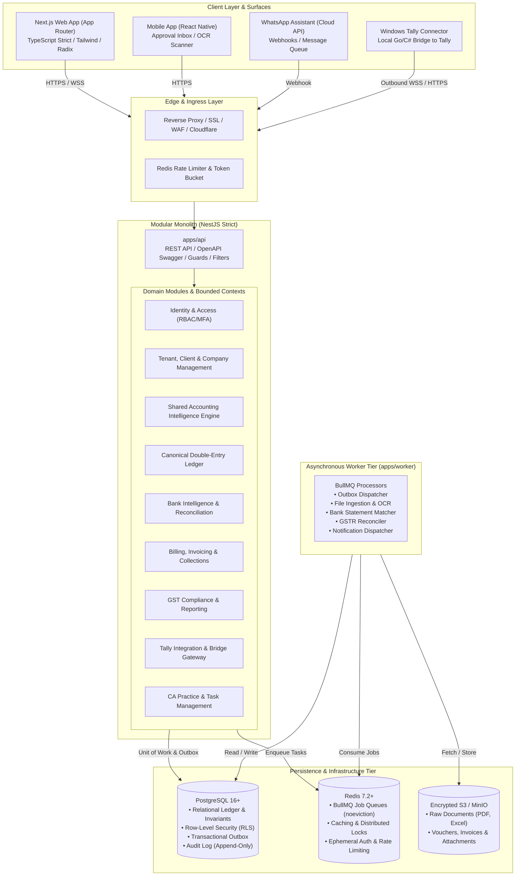
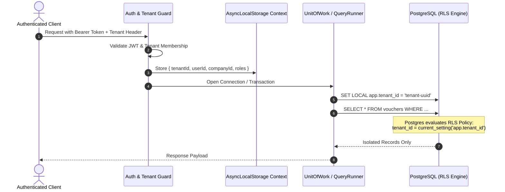
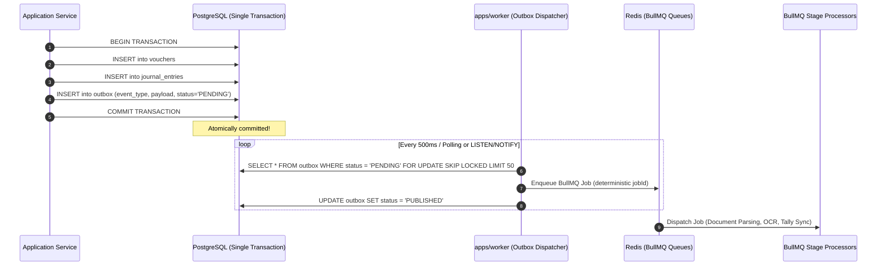
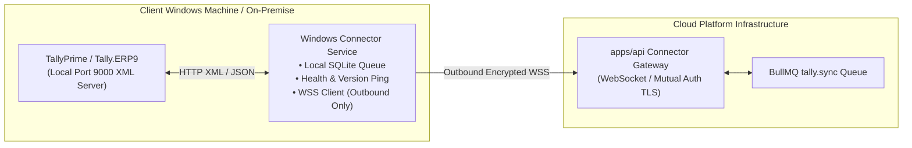

# Document 01: System Architecture Specification

**Project:** End-to-End Accounting Operations Platform  
**Author:** Principal Software Architect & Senior Full-Stack Engineer  
**Status:** Under Review (Step 0)  
**Date:** October 2026  

---

## 1. Architectural Overview & System Topology

The platform is designed as a **modular monolith** adhering strictly to **Domain-Driven Design (DDD)** and **Ports & Adapters (Hexagonal Architecture)** principles. While packaged in a single repository with unified database transactions, every bounded context possesses isolated domain models, application services, and persistence mappers. This guarantees clean boundaries, zero god-classes, and painless future extraction into distributed microservices if transaction volumes ever demand it.



---

## 2. Monorepo Structure & Dependency Rules

The project is structured as a **pnpm workspace** orchestrated by **Turborepo**:

```
.
├── apps/
│   ├── api/                       # NestJS API application (HTTP, Guards, Swagger, Controllers)
│   ├── web/                       # Next.js 14+ App Router frontend application
│   └── worker/                    # NestJS / BullMQ background processor worker application
├── packages/
│   ├── accounting-core/           # PURE domain model: Double-entry engine, ledger aggregates, VO
│   ├── gst-rules/                 # PURE domain model: Deterministic GST & Tax rules engine
│   ├── shared-types/              # Shared TypeScript interfaces, DTOs, job payloads, API contracts
│   ├── ui/                        # Reusable accessible component system (Radix, Tailwind, Tokens)
│   ├── config/                    # Shared ESLint, Prettier, TypeScript, and Tailwind configurations
│   └── testing/                   # Test utilities, Testcontainers helpers, mock fixtures
├── docs/                          # Architectural documentation, ADRs, roadmaps, and guides
├── docker/                        # Dockerfiles, docker-compose.yml, local initialization scripts
└── package.json                   # Root monorepo configuration
```

### Strict Architectural Boundaries & Lint Enforcement
To prevent architectural rot:
1. **Zero Framework Dependencies in Core Domain:** `packages/accounting-core` and `packages/gst-rules` contain **zero** TypeORM decorators, zero NestJS decorators, and zero external database dependencies. They are pure, deterministic TypeScript libraries.
2. **Ports and Adapters:** Application use-cases depend on repository interfaces (e.g., `IVoucherRepository`, `ILedgerRepository`). Infrastructure implementations (TypeORM repositories) reside exclusively in `apps/api/src/infrastructure` or module infrastructure folders.
3. **Dependency Cruising:** `dependency-cruiser` is executed in CI to enforce that:
   - `domain` NEVER imports `infrastructure` or `controllers`.
   - `packages/accounting-core` NEVER imports `apps/*`.
   - Persistence entities are NEVER returned directly to the HTTP layer (domain mappers are strictly required).

---

## 3. Canonical Accounting Model & Ledger Invariants

The heart of the system is the **Canonical Double-Entry Accounting Model**. Every business transaction resolves into balanced debit and credit entries.

### 3.1 Entity-Relationship Diagram (ERD)

```mermaid
erDiagram
    TENANT ||--o{ COMPANY : owns
    COMPANY ||--o{ BRANCH : operates
    COMPANY ||--o{ FINANCIAL_YEAR : defines
    COMPANY ||--o{ LEDGER_GROUP : categorizes
    LEDGER_GROUP ||--o{ LEDGER : organizes
    COMPANY ||--o{ VOUCHER_SEQUENCE : maintains
    
    COMPANY ||--o{ VOUCHER : records
    VOUCHER ||--|{ JOURNAL_ENTRY : contains
    JOURNAL_ENTRY }|--|| LEDGER : posts_to
    
    VOUCHER ||--o{ BILL_REFERENCE : tracks
    VOUCHER ||--o{ TAX_LINE : details
    VOUCHER ||--o| AUDIT_EVENT : traced_by
    VOUCHER ||--o| OUTBOX_EVENT : publishes

    TENANT {
        uuid id PK
        string name
        string slug
        string plan
        timestamp created_at
    }

    COMPANY {
        uuid id PK
        uuid tenant_id FK
        string legal_name
        string pan
        string currency
        timestamp created_at
    }

    VOUCHER {
        uuid id PK
        uuid tenant_id FK
        uuid company_id FK
        uuid branch_id FK
        uuid financial_year_id FK
        string voucher_type
        string voucher_number
        date voucher_date
        string status
        numeric total_amount
        string idempotency_key UK
        uuid source_document_id
        uuid reversal_of_id FK
        int version
        timestamp created_at
    }

    JOURNAL_ENTRY {
        uuid id PK
        uuid tenant_id FK
        uuid voucher_id FK
        uuid ledger_id FK
        string entry_type
        numeric amount
        numeric foreign_amount
        string currency
        string narration
        int line_index
    }

    LEDGER {
        uuid id PK
        uuid tenant_id FK
        uuid company_id FK
        uuid group_id FK
        string code
        string name
        string classification
        boolean is_active
        timestamp created_at
    }
```



### 3.2 Database-Level Invariants (Raw SQL & Triggers)
Application-level validation is insufficient for financial integrity. The following invariants are enforced **directly inside PostgreSQL via migrations**:

1. **Double-Entry Balance Constraint:**
   Every voucher must balance: $\sum \text{debits} = \sum \text{credits}$.
   *Implementation:* A deferred constraint trigger on table `journal_entries`:
   ```sql
   CREATE OR REPLACE FUNCTION trg_verify_voucher_balance()
   RETURNS TRIGGER AS $$
   DECLARE
     v_diff NUMERIC(20,4);
   BEGIN
     SELECT COALESCE(SUM(CASE WHEN entry_type = 'DEBIT' THEN amount ELSE -amount END), 0)
     INTO v_diff
     FROM journal_entries
     WHERE voucher_id = NEW.voucher_id;

     IF v_diff <> 0 THEN
       RAISE EXCEPTION 'Voucher % is unbalanced. Debit-Credit difference is %', NEW.voucher_id, v_diff;
     END IF;
     RETURN NEW;
   END;
   $$ LANGUAGE plpgsql;

   CREATE CONSTRAINT TRIGGER check_voucher_balance_deferred
   AFTER INSERT OR UPDATE ON journal_entries
   DEFERRABLE INITIALLY DEFERRED
   FOR EACH ROW EXECUTE FUNCTION trg_verify_voucher_balance();
   ```

2. **Immutable Posted Entries:**
   Once a voucher reaches `status = 'POSTED'`, its header and associated `journal_entries` cannot be modified or deleted.
   *Implementation:*
   ```sql
   CREATE OR REPLACE FUNCTION trg_enforce_posted_immutability()
   RETURNS TRIGGER AS $$
   BEGIN
     IF OLD.status = 'POSTED' THEN
       RAISE EXCEPTION 'Posted voucher % and its journal entries are immutable. To correct, issue a reversal.', OLD.id;
     END IF;
     RETURN NEW;
   END;
   $$ LANGUAGE plpgsql;

   CREATE TRIGGER enforce_voucher_immutability
   BEFORE UPDATE OR DELETE ON vouchers
   FOR EACH ROW EXECUTE FUNCTION trg_enforce_posted_immutability();

   CREATE TRIGGER enforce_journal_entry_immutability
   BEFORE UPDATE OR DELETE ON journal_entries
   FOR EACH ROW EXECUTE FUNCTION trg_enforce_posted_immutability();
   ```

3. **Period Lock Trigger:**
   Transactions cannot be inserted into or dated within a locked financial period:
   ```sql
   CREATE OR REPLACE FUNCTION trg_check_period_lock()
   RETURNS TRIGGER AS $$
   DECLARE
     v_locked BOOLEAN;
   BEGIN
     SELECT is_locked INTO v_locked
     FROM accounting_periods
     WHERE company_id = NEW.company_id
       AND NEW.voucher_date BETWEEN start_date AND end_date;

     IF v_locked IS TRUE THEN
       RAISE EXCEPTION 'Accounting period for date % is locked. Posting prohibited.', NEW.voucher_date;
     END IF;
     RETURN NEW;
   END;
   $$ LANGUAGE plpgsql;

   CREATE TRIGGER check_period_lock_before_insert
   BEFORE INSERT OR UPDATE ON vouchers
   FOR EACH ROW EXECUTE FUNCTION trg_check_period_lock();
   ```

4. **Non-Negative Amounts:**
   `CHECK (amount > 0)` on `journal_entries`. Debits and credits are differentiated strictly by `entry_type IN ('DEBIT', 'CREDIT')`, preventing signed negative arithmetic confusion.

5. **Idempotency Key Uniqueness:**
   A partial unique index: `CREATE UNIQUE INDEX idx_vouchers_idempotency ON vouchers(tenant_id, company_id, idempotency_key) WHERE idempotency_key IS NOT NULL;`.

### 3.3 Money Representation
- Database storage: `NUMERIC(20,4)`.
- Backend runtime: mapped via a TypeORM `ValueTransformer` to `Decimal.js` instances.
- Zero floating-point arithmetic is permitted in any service or calculation. All math operations utilize `.plus()`, `.minus()`, `.times()`, `.dividedBy()`, and `.toDecimalPlaces()`.

### 3.4 Concurrency & Gap-Free Sequence Generation
Under Indian GST Law (Section 31), invoice numbering must be consecutive and unique within a financial year. To guarantee zero gaps even under high concurrency:
- Sequence tracking table: `voucher_sequences (company_id, voucher_type, series, financial_year, last_sequence)`.
- Sequence allocation executes a pessimistic row lock inside the final Unit-of-Work transaction immediately before voucher insertion:
  ```sql
  SELECT last_sequence 
  FROM voucher_sequences 
  WHERE company_id = $1 AND voucher_type = $2 AND series = $3 AND financial_year = $4 
  FOR UPDATE;
  ```
- If the transaction fails, the number was never committed, preserving gap-free sequences.

---

## 4. Multi-Tenancy & Row-Level Security (RLS)

The platform enforces absolute tenant isolation at the architectural and database layers:



### PostgreSQL Row-Level Security Implementation
Every tenant-owned table (`companies`, `vouchers`, `journal_entries`, `ledgers`, `bank_statements`, etc.) contains a non-nullable `tenant_id UUID` column:
```sql
ALTER TABLE vouchers ENABLE ROW LEVEL SECURITY;
ALTER TABLE vouchers FORCE ROW LEVEL SECURITY;

CREATE POLICY tenant_isolation_policy ON vouchers
FOR ALL
USING (tenant_id = NULLIF(current_setting('app.tenant_id', true), '')::uuid);
```
- In NestJS, every database connection retrieved by the Unit-of-Work executes `SET LOCAL app.tenant_id = :tenantId` inside the transaction.
- If `app.tenant_id` is missing or unset, the query returns zero rows by default.
- Automated integration tests explicitly test cross-tenant read/write attempts to prove isolation cannot be breached.

---

## 5. Shared Accounting Intelligence Engine (AIE)

Every transaction entering the platform—regardless of ingress channel—passes through a unified 8-stage pipeline implemented using the **Chain of Responsibility / Staged Pipeline** pattern:

```mermaid
flowchart LR
    A["Stage 1: INGEST\nRaw payload, MIME verification, virus scan, S3 storage"] --> B["Stage 2: EXTRACT\nOCR / LayoutLM / Parser / Field normalization"]
    B --> C["Stage 3: MASTER MATCH\nFuzzy match customer, vendor, ledgers, items"]
    C --> D["Stage 4: GST RULES\nDeterministic tax rate, POS, HSN, RCM, ITC validation"]
    D --> E["Stage 5: ACC. VALIDATION\nDouble-entry balance, period lock, bill-ref, FY"]
    E --> F["Stage 6: RISK & APPROVAL\nGreen / Yellow / Red / Blue state evaluation"]
    F --> G["Stage 7: POST\nUoW atomic commit (Voucher + Entries + Outbox)"]
    G --> H["Stage 8: VERIFY READ-BACK\nRe-query destination & assert byte/field equality"]
```



### 5.1 Pipeline Stage Responsibilities
1. **Ingest Stage:** Validates file signatures, generates cryptographic content hash (`sha256`), uploads raw payload to encrypted object storage, and checks for duplicate ingestion within 90 days.
2. **Extract Stage:** Dispatches job to OCR/Parser worker. Extracts header, invoice date, party names, GSTINs, line items, quantities, HSN/SAC, rates, and values. Attaches confidence score ($0.00 - 1.00$) per field.
3. **Master Match Stage:** Fuzzy-matches extracted parties against company ledgers. If similarity $< 0.85$, marks as `MISSING_MASTER` and suggests master creation.
4. **GST Rules Stage:** Invokes deterministic `@platform/gst-rules`. Validates State code vs. Place of Supply, checks active GSTIN format, asserts tax calculation math, and flags RCM or blocked ITC under Section 17(5).
5. **Accounting Validation Stage:** Ensures debits equal credits, verifies accounting period is unlocked, confirms voucher numbering series availability, and matches bill-wise allocations.
6. **Risk & Approval Stage:** Assigns operational state:
   - `GREEN (Validated):` All rules pass, confidence high $\rightarrow$ Auto-routes to posting queue (if policy permits).
   - `YELLOW (Clarification):` Low extraction confidence or unverified bank credit $\rightarrow$ Routes to user review queue.
   - `RED (Blocked):` Mandatory GST or balancing failure $\rightarrow$ Posting strictly forbidden until edited.
   - `BLUE (Approval):` Validated transaction requiring Maker-Checker sign-off.
7. **Post Stage:** Executes atomic Unit-of-Work in PostgreSQL (or formats Tally XML request).
8. **Verify Read-Back Stage:** Queries destination, retrieves saved record, and performs field-by-field delta verification before marking voucher `VERIFIED`.

### 5.2 Pluggable AI Engine Abstraction
AI is isolated behind an `AiProvider` interface:
```typescript
export interface AiProvider {
  extractDocument(fileBuffer: Buffer, mimeType: string): Promise<ExtractedDocumentDto>;
  classifyBankNarration(narration: string, context: MatchContext): Promise<NarrationClassificationDto>;
}
```
**Strict AI Mandate:** AI output is treated as unverified external input. AI can populate draft fields, but can **never bypass** the deterministic GST rules engine or database invariants.

---

## 6. Asynchronous Queues & Transactional Outbox Pattern

To eliminate dual-write inconsistencies (e.g., database commit succeeds but Redis/BullMQ enqueue fails), the platform utilizes the **Transactional Outbox Pattern**:



### BullMQ Queue Configuration
- Redis memory policy: configured with `maxmemory-policy noeviction` to prevent queue job loss.
- Key logical queues:
  - `queue.document.ingest`: File parsing, OCR, and table extraction.
  - `queue.bank.process`: Statement parsing and narration matching.
  - `queue.gst.reconcile`: GSTR-2B vs. purchase register 3-way matching.
  - `queue.tally.sync`: Outbound voucher submission and read-back verification.
  - `queue.notification`: Multi-channel notification delivery (WhatsApp, Email, Push).
- Every job payload includes: `tenantId`, `companyId`, `correlationId`, `userId`, `timestamp`.
- Retries: Exponential backoff ($1\text{s}, 5\text{s}, 25\text{s}, 125\text{s}$), dead-letter queue (DLQ) after 5 failed attempts with full error trace persisted to DB.

---

## 7. Tally Integration & Connector Architecture

For Tally-connected clients, the platform provides a lightweight Windows desktop connector:



### Connector Key Design Principles:
- **Zero Inbound Ports:** The connector initiates **outbound-only** connections to the cloud platform over TLS WebSockets. No port forwarding or public IP exposure is required on the client machine.
- **Local Operation Buffer:** If the local internet drops, the connector buffers inbound sync events in a local SQLite file.
- **Posting State Machine:** `QUEUED` $\rightarrow$ `SENT_TO_CONNECTOR` $\rightarrow$ `SUBMITTED_TO_TALLY` $\rightarrow$ `READ_BACK_PENDING` $\rightarrow$ `VERIFIED` | `UNCERTAIN` | `FAILED`.
- **Handling Uncertain Timeouts:** If Tally times out during submission, the status transitions to `UNCERTAIN`. Retries are **blocked** until a read-back query inspects Tally's daybook by date and voucher reference to verify if the record was written, completely preventing duplicate postings.

---

## 8. Security, Cryptography & Compliance

### 8.1 Authentication & Authorization
- **AuthN:** Short-lived JWT access tokens ($15\text{ minutes}$) paired with rotating refresh tokens stored in `httpOnly`, `secure`, `SameSite=Strict` cookies. Optional TOTP-based MFA.
- **AuthZ:** Hybrid RBAC and policy-based authorization (`TenantGuard`, `RolesGuard`, `CompanyAccessGuard`). Deny by default.
  - Roles: `SUPER_ADMIN`, `FIRM_PARTNER`, `STAFF_ACCOUNTANT`, `CLIENT_APPROVER`, `CLIENT_VIEWER`.

### 8.2 Field-Level Encryption at Rest
Sensitive attributes (bank account numbers, IFSC, PAN, Aadhaar references, Tally connector secrets) are encrypted before writing to PostgreSQL using **AES-256-GCM** via a custom TypeORM `ValueTransformer`.
- Initialization vector (IV) and authentication tag are prepended to the ciphertext.
- Master encryption keys are retrieved from environment secrets and never committed to code.

### 8.3 Immutable Audit Trail
Every voucher, invoice, and master record modification generates an immutable audit record in table `audit_logs`:
- Schema: `id, tenant_id, company_id, entity_type, entity_id, action, actor_id, ip_address, correlation_id, payload_before, payload_after, record_hash, created_at`.
- `record_hash`: SHA-256 hash chaining each log entry to the previous entry, providing tamper-evident auditing.

---

## 9. Frontend Architecture (Next.js App Router)

The frontend is built inside `apps/web` using the Next.js App Router:
- **Server Components (RSC):** Utilized for initial page shells, server-side data pre-fetching, and SEO/metadata rendering.
- **Client Components ('use client'):** Utilized for interactive widgets, the virtualized data tables, the guided import wizard, and real-time status trackers.
- **Design System (`packages/ui`):** Headless accessible primitives from Radix UI styled with Tailwind CSS, supporting dark/light mode via design tokens, and adhering to WCAG 2.2 AA.
- **State Management:** 
  - Server state: TanStack Query (React Query) with optimistic updates and cache invalidation.
  - Ephemeral/form state: React Hook Form with Zod schemas shared directly from `packages/shared-types`.
  - Global UI state: Zustand for command palette (Cmd+K) state, sidebar, and notification center.
- **Indian Financial Localization:** Dedicated formatting helpers for Indian currency representation ($₹1,23,45,678.00$ Lakhs/Crores), GSTIN format masks, and `DD/MM/YYYY` date formatters.

---

## 10. Key Architectural Decision Records (ADRs)

### ADR-001: Monorepo Architecture via Turborepo & pnpm
- **Context:** The system requires shared domain libraries (`accounting-core`, `gst-rules`, `shared-types`) between the API backend, background worker, and frontend web client.
- **Decision:** Adopt a pnpm workspace with Turborepo for build caching and pipeline execution.
- **Consequences:** Maximizes code reuse, provides unified TypeScript configurations, and enables atomic commits across frontend and backend boundaries.

### ADR-002: Modular Monolith vs. Microservices
- **Context:** Financial accounting requires strict transactional consistency (Unit-of-Work) across vouchers, entries, outbox, and audit logs.
- **Decision:** Build a modular monolith in NestJS with strict DDD bounded contexts instead of premature microservices.
- **Consequences:** Eliminates distributed transaction failures (Sagas/2PC complexity) in core bookkeeping while maintaining clean domain boundaries that can be detached later if necessary.

### ADR-003: Database-Level Ledger Invariant Enforcement
- **Context:** Application bugs or ad-hoc queries could insert unbalanced entries or mutate posted historical vouchers.
- **Decision:** Enforce double-entry balancing ($\sum \text{debits} = \sum \text{credits}$), period locks, and posted immutability using PostgreSQL constraint triggers and CHECK constraints.
- **Consequences:** Zero possibility of corrupt ledger state reaching disk; full safety guarantee independent of the application layer.

### ADR-004: Transactional Outbox Pattern for BullMQ Event Publishing
- **Context:** Network failure between committing a transaction to PostgreSQL and publishing a job to Redis can cause lost jobs or duplicate processing.
- **Decision:** Domain events are committed to an `outbox` table within the Postgres transaction; an outbox poller dispatches them to BullMQ.
- **Consequences:** Guaranteed at-least-once job delivery with deterministic idempotency keys.

### ADR-005: High-Precision Decimal Representation (`NUMERIC(20,4)` & Decimal.js)
- **Context:** Standard JavaScript IEEE-754 numbers introduce binary floating-point rounding errors that violate statutory tax and ledger balancing.
- **Decision:** Store all monetary figures as `NUMERIC(20,4)` in PostgreSQL and transform them into `Decimal.js` objects in the application layer.
- **Consequences:** Absolute mathematical precision across all currency calculations and GST component divisions.

---

This architectural specification forms the authoritative foundation for Phase 0 and all subsequent implementation milestones.

