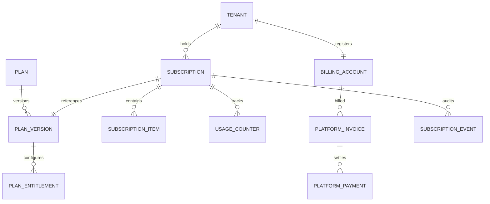
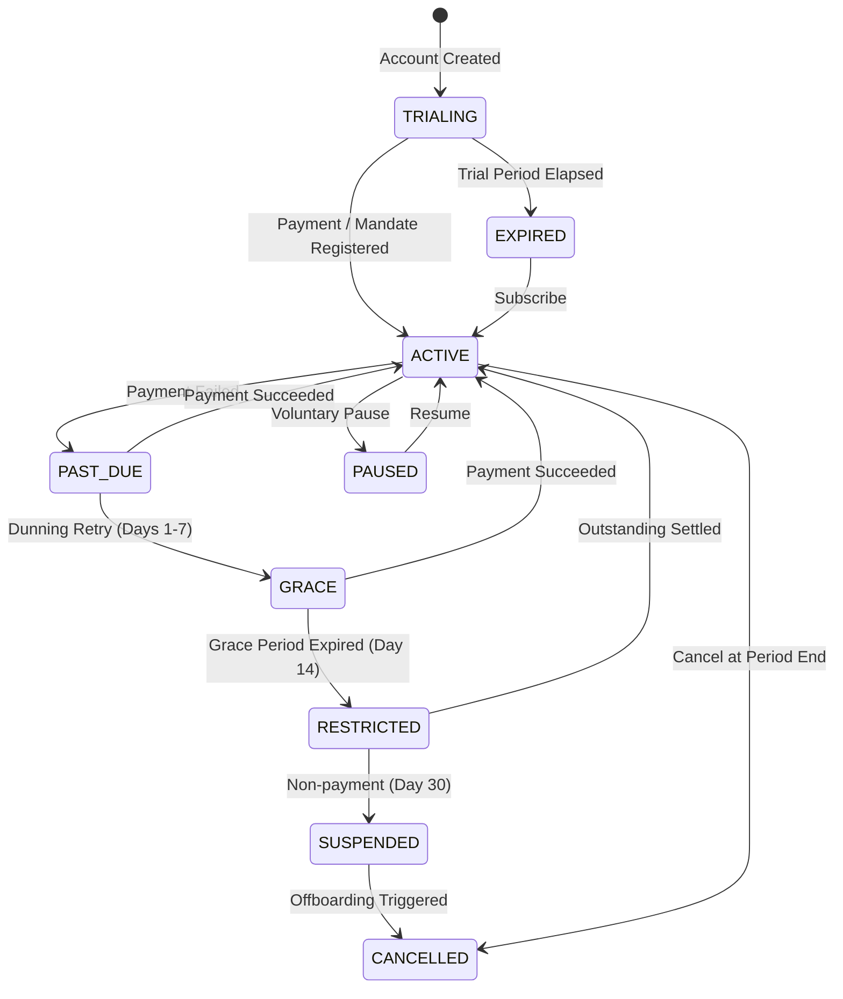
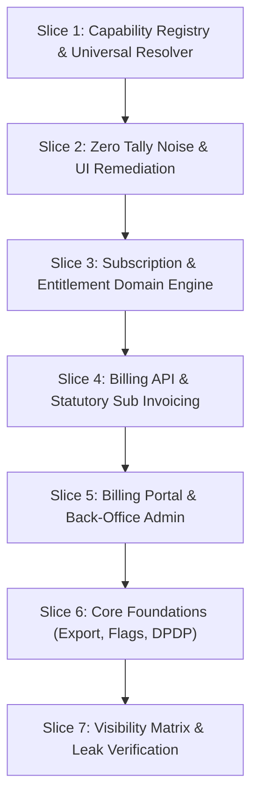

# Capability-Based UI Visibility, Subscriptions & Entitlements, and Core Foundations Implementation Plan

> **Protocol Notice:** In accordance with the execution protocol, this plan is submitted for review and architectural sign-off. **No code modifications will be executed until this plan is formally approved.** All legal, RBI mandate, and commercial items are cross-referenced with [`docs/open-questions.md`](file:///Users/neeraj/Desktop/Neeraj/Personal/Test/docs/open-questions.md) and [`docs/foundations-audit.md`](file:///Users/neeraj/Desktop/Neeraj/Personal/Test/docs/foundations-audit.md).

---

## 1. Executive Summary & Architectural Vision

This implementation unites three foundational workstreams under **one unified capability resolution architecture**:
1. **Workstream 1: Zero Tally Noise & Capability-Based Visibility:** A cloud-native user must never see or know about Tally. All UI visibility and navigation are driven by a single deterministic, 5-layer `CapabilityResolver`.
2. **Workstream 2: Subscription Management & Entitlements:** Plans and limits are pure data, not code. A central `EntitlementService` gates every action, meters usage idempotently via outbox events, and enforces a rock-solid subscription state machine.
3. **Workstream 3: Foundational Architecture Marked NOW:** Delivers feature flags, tenant lifecycle states, single-click complete books portability, DPDP privacy consent, rate limiting, and back-office administrative tooling.

---

## 2. Workstream 1: Capability-Based Visibility & Zero Tally Leakage

### 2.1 The Single `CapabilityResolver` Mechanism
Visibility is never governed by ad-hoc `if (mode === 'tally')` conditions scattered across components. Instead, a single framework-free domain resolver evaluates capabilities:

```typescript
resolve(subject: SubjectContext, context: CompanyContext): ResolvedCapabilities {
  // Evaluated in strict hierarchical order:
  // Layer 1: Company Accounting Mode (TALLY_CONNECTED, CLOUD_NATIVE, HYBRID)
  // Layer 2: Subscription Entitlements (Active plan & add-ons)
  // Layer 3: Role-Based Access Control (RBAC permissions)
  // Layer 4: Feature Flags (Tenant/Company overrides & staged rollout)
  // Layer 5: Company & Branch Settings (Explicit opt-ins, e.g. "Tally export format")
}
```

#### Output Contract
```typescript
export interface ResolvedCapabilities {
  capabilities: Set<CapabilityKey>;
  reasons: Map<CapabilityKey, DenialReason>;
}

export type DenialReason =
  | { code: 'MODE_INCOMPATIBLE'; requiredMode: AccountingMode }
  | { code: 'PLAN_UPGRADE_REQUIRED'; requiredPlan: string; entitlementKey: string }
  | { code: 'PERMISSION_DENIED'; requiredPermission: string }
  | { code: 'FLAG_DISABLED'; flagKey: string }
  | { code: 'SETTING_DISABLED'; settingKey: string };
```

### 2.2 Uniform Visibility Triad: Hide vs Lock vs Show
Every UI element in the platform adheres to this universal rule:

| Condition | UI Treatment | Behavior |
|---|---|---|
| **Not applicable to Mode** | **HIDDEN ENTIRELY** | Zero visual footprint. No teaser, no upsell, no ghost space. (e.g. Tally connector for cloud-native companies). |
| **Applicable to Mode, but not in Subscription Plan** | **LOCKED & VISIBLE** | Rendered with `<LockedFeature>` component or disabled state displaying "Available on &lt;Plan&gt; — Upgrade" CTA. |
| **In Plan & Mode, but User lacks Role Permission** | **HIDDEN OR DISABLED** | Disabled with explanatory tooltip ("Requires Administrator privileges"). |
| **All Children of a Menu/Section Hidden** | **PARENT HIDDEN** | Never display an empty section, empty tab, or vacant dropdown menu. |

### 2.3 Comprehensive Tally Leakage Eradication Map
Based on our codebase scan (385 matches across 32 files), the following surfaces will be systematically remediated:

```
┌─────────────────────────────────┬──────────────────────────────────────────────────────────────┐
│ Surface                         │ Remediation Applied via CapabilityResolver                   │
├─────────────────────────────────┼──────────────────────────────────────────────────────────────┤
│ 1. Sidebar (`sidebar.tsx`)      │ Guard `Tally Prime Bridge` link & bottom status widget behind│
│                                 │ `Capability.TALLY_CONNECTOR`.                                │
│ 2. Top Header (`top-header.tsx`)│ Hide the `Tally: Online/Standby` indicator pill completely   │
│                                 │ when company is `CLOUD_NATIVE`.                              │
│ 3. Command Palette (`*.tsx`)    │ Filter out `mst-tally` and all Tally commands unless active. │
│ 4. Dashboard (`page.tsx`)       │ Replace Tally KPI card & Tally Prime Bridge navigation card  │
│                                 │ with Native General Ledger & Bank Feeds cards for cloud mode.│
│ 5. Ledgers (`ledgers/page.tsx`) │ Hide "Tally Group Alias" & "Tally Ledger Alias" form fields. │
│                                 │ Replace "28 Tally Groups" with "Standard Statutory Groups".  │
│ 6. Invoice Templates (`*.tsx`)  │ Rename `TALLY_CLASSIC` to `STATUTORY_CLASSIC` ("Rule 46      │
│                                 │ Statutory Format"). The design is Indian GST Rule 46 standard│
│ 7. Settings (`/settings/tally`) │ Route is 404/403 for cloud-native tenants. Disappear from nav│
│ 8. API Endpoints (`/v1/*/tally`)│ Protect with `@RequiresCapability(Capability.TALLY_CONNECTOR)│
│                                 │ Returning 403 Forbidden for non-Tally tenants.               │
└─────────────────────────────────┴──────────────────────────────────────────────────────────────┘
```

### 2.4 Mode Changes & Guided Migration
* **Accounting Modes:**
  1. `CLOUD_NATIVE`: Platform is the sole source of truth. Zero Tally terminology anywhere.
  2. `TALLY_CONNECTED`: Tally is the master for ledgers/vouchers; platform acts as smart GST/BRS front-end.
  3. `HYBRID`: Clearly defined authority boundary (e.g., Billing in Cloud, Banking in Tally).
* **Mode Switch Workflow:**
  * Mode changes occur via an audited wizard at `/settings/accounting-mode`.
  * Pre-flight impact analysis: Displays exactly which menus, capabilities, and data sync workflows will activate or deactivate.
  * **Zero Data Loss:** Past sync logs, historical mappings, and voucher references are safely retained in DB but hidden from main UI.
  * Onboarding asks on Step 1: *"How will you manage your books?"*
    * `[ ] I use Tally Prime (Connect existing company)`
    * `[ ] Cloud-native (Maintain complete books here)`
    * `[ ] Migrating from Tally (One-time import & switch to cloud)`

### 2.5 Backend Enforcement & Guard Architecture
* **NestJS Guard:** `@RequiresCapability(CapabilityKey)` applied at controller or method level.
* **Worker Guard:** BullMQ background job processors verify tenant capability prior to executing sync envelopes.
* **HTTP Status Code Policy:**
  * Returns **403 Forbidden** with standardized error envelope:
    `{ statusCode: 403, error: 'CAPABILITY_DENIED', capability: 'tally.connector', reason: 'MODE_INCOMPATIBLE' }`.

---

## 3. Workstream 2: Subscription & Entitlements Management

### 3.1 Core Principles
1. **Plans are Data, Not Code:** Pricing, quotas, and feature flags are stored in PostgreSQL tables, never hardcoded in TypeScript.
2. **One Entitlement Service:** Feature code checks `entitlementService.hasAccess(companyId, 'bank.intelligence')` or `entitlementService.checkLimit(companyId, 'invoices.monthly')`.
3. **No Customer Data Destruction:** Failure to pay transitions tenants into `RESTRICTED` (read-only) mode. Books are never deleted due to billing.

### 3.2 Domain Data Model (TypeORM Entities)



* **`Plan` & `PlanVersion`:** Immutable versioning. Existing subscribers remain grandfathered on their purchased version when prices change.
* **`PlanEntitlement`:** Key-value rule (`boolean`, `limit`, `quota`) with period (`MONTHLY`, `ANNUAL`, `LIFETIME`) and overage policy (`HARD_BLOCK`, `SOFT_WARN`, `METERED_OVERAGE`).
* **`BillingAccount`:** Legal business identity, verified GSTIN, billing address, state code, PAN, and billing contact email.
* **`PlatformInvoice` & `PlatformInvoiceLine`:** Our platform's own statutory GST invoices issued to customers, sequenced via `NumberingService`.
* **`Payment` & `PaymentMethod`:** Tokenized gateway payment records (Razorpay / Cashfree tokens; zero raw card data stored).
* **`SubscriptionEvent`:** Append-only audit history of every transition, upgrade, downgrade, and cancellation.

### 3.3 Subscription State Machine



#### State Capabilities Matrix
* `TRIALING` / `ACTIVE`: Full read/write access per plan entitlements.
* `PAST_DUE` / `GRACE`: Full read/write access + prominent banner alerting billing contact.
* `RESTRICTED`: **Strictly Read-Only**. Full data export, reporting, and tax audit trails remain accessible. New invoice generation, voucher posting, and bank uploads are blocked with clear upgrade prompt.
* `SUSPENDED` / `CANCELLED`: Login allowed only to Billing & Complete Books Export.

### 3.4 Idempotent Metering Architecture
1. **Event Capture:** Use-case actions emit a `UsageEvent` via the transactional outbox (`outbox.orm-entity.ts`).
2. **Worker Aggregation:** BullMQ consumer aggregates events into `UsageCounter` rows in PostgreSQL (source of truth).
3. **Atomic Enforcement:** `EntitlementService.checkAndIncrement(companyId, key, qty)` executes atomic check in PostgreSQL with Redis distributed lock to prevent concurrent quota overruns.
4. **Drift Reconciliation:** Scheduled nightly cron reconciles `UsageCounter` against actual document count in `invoices`, `vouchers`, and `bank_transactions`.

### 3.5 Payment Gateway Adapter Pattern
* **Interface `PaymentGateway`:**
  * `createCustomer(billingAccount: BillingAccount): Promise<string>`
  * `createSubscription(plan: PlanVersion, mandate: MandateConfig): Promise<GatewaySubscriptionResult>`
  * `chargeOneTime(amount: Money, token: string): Promise<PaymentResult>`
  * `verifyWebhook(payload: Buffer, signature: string): WebhookEvent`
  * `cancelSubscription(gatewaySubId: string): Promise<void>`
* **Initial Adapters:**
  1. `FakePaymentGatewayAdapter`: In-memory simulator for unit and integration tests.
  2. `SandboxPaymentGatewayAdapter`: Connects to gateway sandbox API.
  3. Live gateway adapter implemented via approved ADR (candidates in `docs/open-questions.md`).

### 3.6 UI Components (`packages/ui`)
* `<LockedFeature feature="bank.intelligence" requiredPlan="Accounting Pro" />`: Consistent gate banner with one-click upgrade modal.
* `<LimitWarningBanner key="invoices" current={85} limit={100} />`: Warning prompt at 80% and 90% consumption.
* **Customer Billing Center (`/settings/billing`):** Plan overview, usage gauges, invoice history, payment method manager, and proration preview.
* **Back-Office Admin Console (`/admin/tenants/:id/billing`):** Privileged manual overrides, trial extensions, and support credits.

---

## 4. Workstream 3: Foundational Architecture Marked NOW

In accordance with [`docs/foundations-audit.md`](file:///Users/neeraj/Desktop/Neeraj/Personal/Test/docs/foundations-audit.md), the following foundations are incorporated into the vertical slices:

1. **Feature Flags Engine:** Staged rollout engine integrated as Layer 4 of `CapabilityResolver`.
2. **Tenant Lifecycle & Retention Guard:** Implementation of `RESTRICTED` read-only mode and 8-year statutory data retention protections.
3. **Single-Click Complete Books Portability:** Streaming ZIP archive generation (`/v1/companies/:id/export/complete-books`) containing General Ledger CSVs, Chart of Accounts JSON, and audit manifests.
4. **DPDP Privacy & Consent Records:** Append-only `ConsentRecordOrmEntity` capturing user and CA firm ToS/DPA versioned acceptances.
5. **Rate Limiting & Abuse Protection:** `@nestjs/throttler` with Redis storage protecting authentication, OCR, and bulk import routes.
6. **AI Token Metering & Controls:** Credit ledger tracking LLM narration tagging tokens with hard caps and regex PII prompt sanitization.
7. **Basic Observability & Business Health Probes:** Prometheus metrics tracking failed voucher posts, outbox lag, and Redis health.
8. **Security Hardening:** HTTP security headers (Helmet), encrypted column key rotation hooks, and session timeout policies.
9. **Scale & Table Partitioning Strategy:** Documented declarative PostgreSQL partitioning scheme for `journal_entries` by financial year.

---

## 5. Phased Implementation Roadmap (Vertical Slices)



### Slice 1: Capability Registry & Universal Resolver (Domain & Shared Types)
* Define typed enum `CapabilityKey` and `DenialReason` in `packages/shared-types`.
* Implement `CapabilityResolver` in `packages/accounting-core` with 5-layer resolution logic.
* Implement NestJS backend guard `@RequiresCapability()`.
* Add frontend React hook `useCapabilities()` and `useHasCapability(key)`.

### Slice 2: Zero Tally Noise & UI Remediation
* Implement `AccountingMode` (`CLOUD_NATIVE`, `TALLY_CONNECTED`, `HYBRID`) on `CompanyOrmEntity`.
* Apply `CapabilityResolver` across Sidebar, Top Navbar, Command Palette, Dashboard, and Ledgers.
* Rename `TALLY_CLASSIC` invoice template to `STATUTORY_CLASSIC` (Rule 46 statutory format).
* Hide all Tally alias fields in ledger and group dialogs when in cloud-native mode.
* Implement guided Accounting Mode switch wizard (`/settings/accounting-mode`).

### Slice 3: Subscription & Entitlement Domain Engine
* Author TypeORM migration for `plans`, `plan_versions`, `plan_entitlements`, `subscriptions`, `billing_accounts`, `usage_counters`, `subscription_events`.
* Seed standard placeholder plans (`STARTER_BILLING`, `BUSINESS`, `ACCOUNTING_PRO`, `CA_PRACTICE`, `ENTERPRISE`).
* Implement `EntitlementService` with atomic check-and-increment and BullMQ usage metering.
* Implement subscription state machine and transition validators.

### Slice 4: Billing API & Statutory Subscription Invoicing
* Implement platform customer invoicing (`PlatformInvoiceOrmEntity`) with Indian GST rules and `NumberingService`.
* Implement `PaymentGateway` port and `FakePaymentGatewayAdapter` for deterministic testing.
* Add webhook ingress handler with HMAC verification, replay defense, and idempotency.

### Slice 5: Customer Billing Portal, `<LockedFeature>` & Back-Office Admin
* Build customer billing dashboard (`/settings/billing`) using `@platform/ui`.
* Create reusable `<LockedFeature>` component for locked capabilities.
* Build internal admin console (`/admin/subscriptions`) with audited manual override capability.

### Slice 6: Core Foundations (Export, Flags, DPDP, Rate Limits)
* Build single-click Complete Books Export (`/v1/companies/:id/export/complete-books`).
* Implement Redis rate-limiting guard on public and upload endpoints.
* Implement DPDP `ConsentRecordOrmEntity` and terms acceptance dialog.
* Implement AI token credit ledger with PII prompt sanitizer.

### Slice 7: Verification Suite & Automated Asserts
* **Visibility Matrix Test:** Automated test iterating `(Mode × Plan × Role)` asserting visible navigation and API availability.
* **String Leak Test:** Automated test asserting the string `"Tally"` never appears on rendered screens, exports, or PDFs for a cloud-native tenant.
* **Concurrency Quota Test:** Parallel execution tests proving concurrent requests cannot breach plan limits.

---

## 6. Definition of Done & Sign-Off Criteria

1. **Zero Tally Leakage:** A company in `CLOUD_NATIVE` mode displays zero references to Tally in navbars, menus, forms, badges, tooltips, or PDFs (proven by automated string-leak test).
2. **Unified Visibility:** All UI visibility is driven strictly by `CapabilityResolver`.
3. **Subscriptions as Data:** Plans and entitlements are 100% database-driven with placeholder tiers seeded cleanly.
4. **Statutory Integrity:** Subscription invoices comply with Rule 46 GST guidelines.
5. **No Data Loss:** Non-payment results in `RESTRICTED` mode; books of accounts are preserved for the statutory 8-year retention requirement.
6. **Tests Green:** All unit, integration, and concurrency tests pass.
7. **Documentation Complete:** ADRs, state machine specs, and capability registry documentation finalized.

---

> [!IMPORTANT]
> **AWAITING USER APPROVAL:** The audit and plan are complete. No code changes have been made. Please review and provide sign-off to proceed with Slice 1 implementation.

