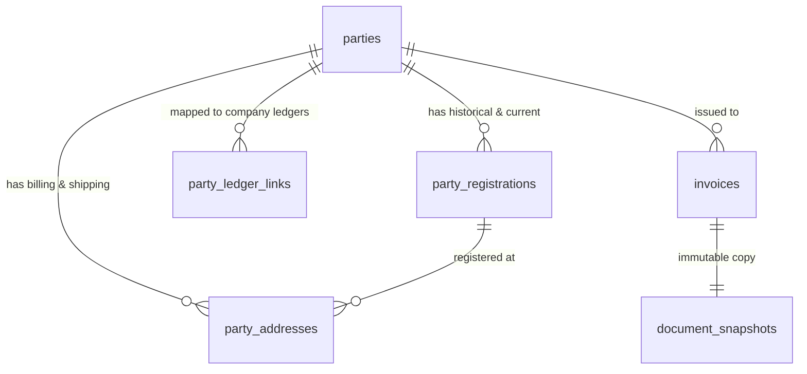

# Party Master, GST Registration, Address and Tax-Treatment Integrity Fix Plan

**Plan Document:** `docs/phases/party-fix-plan.md`  
**Audit Reference:** `docs/party-audit.md`  
**Statutory Verification Log:** `docs/open-questions.md`  
**Status:** Pending User Approval Before Build  
**Goal:** Guarantee that no known, preventable master-data or tax-treatment error can reach a posted voucher or issued document.

---

## 1. ARCHITECTURAL BLUEPRINT & DATA MODEL

### 1.1 Relational Schema & Tables
We will create a multi-entity relational model replacing the current flattened `parties` table through TypeORM migration `1731300000000-PartyMasterGstIntegrityAndSnapshots.ts`.



#### Table 1: `parties` (Legal Master Identity)
- `id`: UUID (PK)
- `tenant_id`: UUID (Index, FK `tenants.id`)
- `company_id`: UUID (Index, FK `companies.id`)
- `party_code`: VARCHAR(50) (Auto-allocated via `NumberingService`, e.g. `CUST-0001`, `VEND-0001`)
- `name`: VARCHAR(255) NOT NULL (Normalized legal entity name)
- `trade_name`: VARCHAR(255) NULL (Commercial brand/trade name)
- `party_type`: VARCHAR(50) NOT NULL (`CUSTOMER`, `VENDOR`, `BOTH`)
- `registration_type`: VARCHAR(50) NOT NULL (`REGULAR`, `COMPOSITION`, `UNREGISTERED`, `SEZ_UNIT`, `SEZ_DEVELOPER`, `DEEMED_EXPORT`, `OVERSEAS`, `UIN_HOLDER`)
- `pan`: VARCHAR(10) NULL
- `email`: VARCHAR(255) NULL
- `phone`: VARCHAR(50) NULL
- `currency`: VARCHAR(3) NOT NULL DEFAULT 'INR'
- `credit_limit`: NUMERIC(18, 4) NOT NULL DEFAULT 0
- `payment_terms_days`: INT NOT NULL DEFAULT 30
- `is_active`: BOOLEAN NOT NULL DEFAULT TRUE
- `created_at` / `updated_at`: TIMESTAMPTZ

#### Table 2: `party_registrations` (Effective-Dated GST Registrations)
- `id`: UUID (PK)
- `tenant_id`: UUID (Index)
- `company_id`: UUID (Index)
- `party_id`: UUID NOT NULL (FK `parties.id` ON DELETE CASCADE)
- `registration_type`: VARCHAR(50) NOT NULL
- `gstin`: VARCHAR(15) NULL (Validated 15-char Mod-36 checksum, NULL for UNREGISTERED/OVERSEAS)
- `state_code`: VARCHAR(2) NOT NULL (Derived from GSTIN or jurisdiction)
- `legal_name`: VARCHAR(255) NULL (As registered on GST portal)
- `trade_name`: VARCHAR(255) NULL
- `status`: VARCHAR(50) NOT NULL DEFAULT 'ACTIVE' (`ACTIVE`, `SUSPENDED`, `CANCELLED`)
- `valid_from`: DATE NOT NULL DEFAULT CURRENT_DATE
- `valid_to`: DATE NULL (NULL = currently active)
- `verification_status`: VARCHAR(50) NOT NULL DEFAULT 'UNVERIFIED' (`VERIFIED`, `UNVERIFIED`, `FAILED`, `PROVIDER_DOWN`)
- `verified_at`: TIMESTAMPTZ NULL
- `verification_source`: VARCHAR(100) NULL
- **Constraint:** Partial unique index: `UNIQUE (company_id, gstin) WHERE gstin IS NOT NULL AND status = 'ACTIVE'`.
- **Constraint:** CHECK: `(registration_type IN ('UNREGISTERED', 'OVERSEAS') AND gstin IS NULL) OR (registration_type NOT IN ('UNREGISTERED', 'OVERSEAS') AND gstin IS NOT NULL)`.

#### Table 3: `party_addresses` (Multi-Site Shipping & Billing)
- `id`: UUID (PK)
- `tenant_id`: UUID (Index)
- `company_id`: UUID (Index)
- `party_id`: UUID NOT NULL (FK `parties.id` ON DELETE CASCADE)
- `registration_id`: UUID NULL (FK `party_registrations.id` ON DELETE SET NULL)
- `address_type`: VARCHAR(20) NOT NULL (`BILLING`, `SHIPPING`)
- `label`: VARCHAR(100) NOT NULL DEFAULT 'Main Office' (e.g. 'Bhiwandi Warehouse', 'Headquarters')
- `address_line1`: VARCHAR(255) NOT NULL
- `address_line2`: VARCHAR(255) NULL
- `city`: VARCHAR(100) NOT NULL
- `state_code`: VARCHAR(2) NOT NULL (FK `indian_gst_states.code`)
- `pincode`: VARCHAR(10) NOT NULL
- `country`: VARCHAR(3) NOT NULL DEFAULT 'IND'
- `is_default_billing`: BOOLEAN NOT NULL DEFAULT FALSE
- `is_default_shipping`: BOOLEAN NOT NULL DEFAULT FALSE
- **Constraint:** Partial unique index: Exactly one `is_default_billing = TRUE` per party.
- **Constraint:** Partial unique index: Exactly one `is_default_shipping = TRUE` per party.
- **Constraint:** CHECK: If `registration_id` is present, `state_code` must match the registration's `state_code`.

#### Table 4: `party_ledger_links` (Company-Scoped Sub-Ledgers)
- `id`: UUID (PK)
- `tenant_id`: UUID
- `company_id`: UUID
- `party_id`: UUID NOT NULL (FK `parties.id` ON DELETE CASCADE)
- `ledger_id`: UUID NOT NULL (FK `ledgers.id` ON DELETE RESTRICT)
- `link_type`: VARCHAR(50) NOT NULL (`RECEIVABLE_DEBTOR`, `PAYABLE_CREDITOR`)
- **Constraint:** `UNIQUE (company_id, party_id, link_type)`
- Auto-provisions dedicated 4-digit sub-ledgers under `Sundry Debtors` (`1160`) or `Sundry Creditors` (`2130`). If a party is `BOTH`, provisions two distinct sub-ledgers with bill-wise reconciliation.

#### Table 5: Invoices & Vouchers Party Snapshot Columns
Add snapshot columns to `invoices` table:
- `party_name_snapshot`: VARCHAR(255) NOT NULL
- `party_trade_name_snapshot`: VARCHAR(255) NULL
- `party_registration_type_snapshot`: VARCHAR(50) NOT NULL
- `party_gstin_snapshot`: VARCHAR(15) NULL (Enforced NULL if UNREGISTERED)
- `party_pan_snapshot`: VARCHAR(10) NULL
- `billing_address_snapshot`: JSONB NOT NULL
- `shipping_address_snapshot`: JSONB NOT NULL
- `tax_rule_version_snapshot`: VARCHAR(50) NOT NULL
- `tax_rate_sources_snapshot`: JSONB NOT NULL (Source of rate per line item)

---

## 2. THE SINGLE DECLARATIVE REGISTRATION POLICY

We will build `PartyRegistrationPolicy` in `packages/gst-rules/src/party-registration-policy.ts`:

```typescript
export interface RegistrationRule {
  type: PartyRegistrationType;
  label: string;
  gstinRequirement: 'REQUIRED' | 'FORBIDDEN' | 'OPTIONAL';
  stateRequired: boolean;
  countryRequired: boolean;
  panRequired: boolean;
  allowsB2BInvoice: boolean;
  allowsB2CInvoice: boolean;
  billOfSupplyOnly: boolean;
  rcmApplicability: 'NEVER' | 'CONDITIONAL_REVIEW' | 'MANDATORY';
  sezTreatment: boolean;
  exportTreatment: boolean;
  uinTreatment: boolean;
  tallyRegistrationType: string; // 'Regular', 'Composition', 'Consumer', 'Unregistered'
}
```

### Policy Truth Matrix
| Registration Type | GSTIN | State | PAN | Allowed Docs | Tax Split | Tally Mapping |
| :--- | :--- | :--- | :--- | :--- | :--- | :--- |
| `UNREGISTERED` | **FORBIDDEN (NULL)** | Mandatory | Optional | B2C Tax Invoice / Bill of Supply | CGST+SGST / IGST by POS | `Consumer` / `Unregistered` |
| `REGULAR` | **REQUIRED (15 chars)** | Derived from GSTIN | Embedded in GSTIN | B2B Tax Invoice | CGST+SGST / IGST by POS | `Regular` |
| `COMPOSITION` | **REQUIRED (15 chars)** | Derived from GSTIN | Embedded in GSTIN | Bill of Supply Only (No ITC) | Nil Rated / No Tax | `Composition` |
| `SEZ_UNIT` | **REQUIRED (15 chars)** | Derived from GSTIN | Embedded in GSTIN | Tax Invoice (LUT / IGST) | Inter-State IGST Deemed | `Regular` (SEZ Flag) |
| `SEZ_DEVELOPER` | **REQUIRED (15 chars)** | Derived from GSTIN | Embedded in GSTIN | Tax Invoice (LUT / IGST) | Inter-State IGST Deemed | `Regular` (SEZ Flag) |
| `DEEMED_EXPORT` | **REQUIRED (15 chars)** | Derived from GSTIN | Embedded in GSTIN | Tax Invoice (IGST) | Inter-State IGST | `Regular` |
| `OVERSEAS` | **FORBIDDEN (NULL)** | Non-India | Optional | Export Invoice (LUT / IGST) | Zero-Rated Export | `Unregistered` |
| `UIN_HOLDER` | **REQUIRED (15 chars UIN)** | Derived from UIN | Optional | B2B Invoice with UIN | IGST or Intra by POS | `Regular` |

---

## 3. GSTIN VALIDATION & VERIFICATION ADAPTER

In `packages/gst-rules/src/gstin-validator.ts`:
1. **Normalisation:** Trim and uppercase automatically.
2. **Statutory Syntax:** 15 characters, regex matching, valid CBIC state code `01`–`37`.
3. **Mod-36 Checksum Verification:** Character 15 calculated against characters 1–14 with factor 1–2 alternating weights.
4. **Cross-Checks:**
   - GSTIN state code must match address state code.
   - Characters 3–12 must match the party's stored PAN.
5. **Provider Interface:**
   ```typescript
   export interface GstinVerificationProvider {
     verifyGstin(gstin: string): Promise<{
       status: 'VERIFIED' | 'UNVERIFIED' | 'FAILED' | 'PROVIDER_DOWN';
       legalName?: string;
       tradeName?: string;
       registrationDate?: string;
       taxpayerType?: string;
       active: boolean;
       error?: string;
     }>;
   }
   ```
   A provider network timeout or API quota limit returns `PROVIDER_DOWN`, leaving the record flagged as `UNVERIFIED` without blocking offline work.

---

## 4. PLACE OF SUPPLY & TAX-SPLIT ENGINE REFACTOR

Enhance `resolvePlaceOfSupply` in `packages/gst-rules/src/place-of-supply.ts`:
- **Inputs:**
  - `supplyCategory`: `GOODS` | `SERVICES`
  - `supplierStateCode`: string
  - `recipientRegistrationType`: `PartyRegistrationType`
  - `billingStateCode`: string
  - `shippingStateCode`: string
  - `isSez`: boolean
  - `isExport`: boolean
  - `isDeemedExport`: boolean
- **Logic:**
  1. Export $\rightarrow$ Zero-Rated Inter-State IGST.
  2. SEZ $\rightarrow$ Section 7(5)(b) IGST Act deemed Inter-State IGST.
  3. Goods with different Ship-to State (Triangulation / Section 10(1)(a) vs 10(1)(b)): Place of supply is determined by goods movement termination unless explicitly designated as third-party bill-to delivery.
  4. Services (Section 12(2)): B2B $\rightarrow$ Location of registered recipient. B2C $\rightarrow$ Location of recipient on record; if no address on record $\rightarrow$ Location of supplier.
  5. If required state codes are missing or invalid $\rightarrow$ Returns `RiskApprovalState.YELLOW` ("Needs Clarification"), preventing automated posting until verified.

---

## 5. TAX-RATE RESOLUTION ENGINE (`TaxRateResolver`)

Create `TaxRateResolver` in `packages/gst-rules/src/tax-rate-resolver.ts`:
- **Precedence Order:**
  1. Item Master HSN/SAC statutory rate (effective-dated).
  2. Documented Party/Customer special concession rate (must carry authorization notification reference and reason).
  3. Voucher-line manual override (requires elevated RBAC permission, justification reason, and triggers Yellow maker-checker flag).
- If an item is taxable and HSN/rate is missing $\rightarrow$ Returns `RiskApprovalState.RED` (blocks posting).
- The resolver output snapshots `{ resolvedRate, source: 'ITEM_MASTER' | 'PARTY_OVERRIDE' | 'MANUAL_OVERRIDE', reason, ruleVersion }` directly onto the voucher line item.

---

## 6. VOUCHER SNAPSHOT & IMMUTABILITY (FIXING PART A ROOT CAUSE)

1. At the moment an invoice is created/issued, `InvoiceService` takes an immutable snapshot of:
   - `party_name_snapshot`
   - `party_registration_type_snapshot`
   - `party_gstin_snapshot` (guaranteed `NULL` if unregistered)
   - `billing_address_snapshot`
   - `shipping_address_snapshot`
2. Update all UI components (`invoice-party-details.tsx`, `invoice-header-fields.tsx`), PDF generators, and exports:
   - Always read from the **snapshot** columns for issued/posted documents.
   - Use the shared helper `renderPartyTaxIdentity(snapshot)`:
     - If `registrationType === 'UNREGISTERED'` $\rightarrow$ Render badge `"Unregistered / Consumer"`, **never emit "GSTIN:" string**.
     - If `registrationType === 'REGULAR'` $\rightarrow$ Render `"GSTIN: 27AABCA1234F1Z5"`.
     - If `registrationType === 'COMPOSITION'` $\rightarrow$ Render `"Composition Dealer (No ITC)"`.
     - If `registrationType === 'OVERSEAS'` $\rightarrow$ Render `"Overseas / Export Customer"`.

---

## 7. USER INTERFACE REDESIGN (`apps/web`)

1. **`PartyForm` (`party-dialog.tsx`):**
   - Step 1: Select `Party Type` (`Customer`, `Vendor`, `Both`) and `Registration Type` (`Regular`, `Unregistered / Consumer`, `Composition`, `SEZ Unit`, `Overseas`, etc.).
   - Driven dynamically by `PartyRegistrationPolicy`:
     - If `UNREGISTERED` is selected: Hide GSTIN field entirely; display an info banner: *"Consumer / Unregistered party. B2C invoices will be issued without tax credit. GSTIN is disabled."*
     - If `REGULAR` or `COMPOSITION`: Display GSTIN input with auto-formatting, live checksum feedback, and auto-populated State.
     - If `OVERSEAS`: Display Country selector and Currency dropdown; hide GSTIN.
   - Changing registration type from `Regular` to `Unregistered` prompts: *"Switching to Unregistered will remove GSTIN 27... and future invoices will be B2C. Historical vouchers will remain unchanged. Confirm?"*
2. **Party Directory Page (`parties/page.tsx`):**
   - Replace raw GSTIN column with a structured `Tax Registration` column showing `Registration Type` badge and GSTIN only when valid.
   - Duplicate warning: warns user inline if a party with the same PAN or GSTIN already exists.
3. **Invoice Detail Review Panel:**
   - Displays Place of Supply calculation audit trail (Supplier State vs Recipient State $\rightarrow$ Intra vs Inter-State rule applied).

---

## 8. TALLY XML EXPORT INTEGRATION

Update `TallyGatewayService.generateTallyXmlEnvelope`:
- For each party ledger, emit official TallyPrime statutory tags:
  ```xml
  <GSTREGISTRATIONTYPE>${tallyRegType}</GSTREGISTRATIONTYPE>
  <PARTYGSTIN>${partyGstin || ''}</PARTYGSTIN>
  <STATENAME>${stateName}</STATENAME>
  <COUNTRYNAME>${countryName}</COUNTRYNAME>
  <ISBILLWISEON>Yes</ISBILLWISEON>
  ```
- If the party is `UNREGISTERED`, emit `<GSTREGISTRATIONTYPE>Unregistered</GSTREGISTRATIONTYPE>` and `<PARTYGSTIN></PARTYGSTIN>`.

---

## 9. IMPLEMENTATION VERTICAL SLICES

- **Slice 1: Schema Migration & Entity Mapping**
  - TypeORM migration `1731300000000-PartyMasterGstIntegrityAndSnapshots.ts`.
  - Entities: `PartyOrmEntity`, `PartyRegistrationOrmEntity`, `PartyAddressOrmEntity`, `PartyLedgerLinkOrmEntity`, `InvoiceOrmEntity` snapshot columns.
  - PostgreSQL constraints and triggers.
- **Slice 2: GST Rules Domain Engine (`@platform/gst-rules`)**
  - Implement `PartyRegistrationPolicy` with truth matrix.
  - Refactor `resolvePlaceOfSupply` for goods vs services and triangulation.
  - Implement `TaxRateResolver` with precedence and audit snapshots.
  - Shared party tax identity formatter `formatPartyTaxIdentity`.
- **Slice 3: API Party Master & Ledger Auto-Provisioning (`@platform/api`)**
  - Refactor `PartyService` to manage multi-address and registrations.
  - Auto-provision dedicated 4-digit sub-ledgers via `NumberingService`.
  - Duplicate detection engine (PAN/GSTIN/name similarity).
- **Slice 4: Invoice Service Snapshot & Voucher Blocking Rules**
  - Wire immutable snapshotting into `InvoiceService.createInvoice` and `approveInvoice`.
  - Enforce blocking rules: block GSTIN on unregistered invoices, block B2B on unregistered parties, block invalid GSTINs.
- **Slice 5: UI Refactoring (`apps/web`)**
  - Refactor `PartyDialog` with policy-driven conditional fields.
  - Update `invoice-party-details.tsx`, `invoice-header-fields.tsx`, and `parties/page.tsx` using `formatPartyTaxIdentity`.
- **Slice 6: Tally XML Sync & Import Validator**
  - Update `TallyGatewayService` with TallyPrime statutory tags.
  - Update `ImportValidationService` to route registration conflicts to review.
- **Slice 7: Automated Test Suite & E2E Verification**
  - Policy matrix unit tests, property tests, snapshot immutability tests, DB constraint tests, and Playwright E2E.

---

## 10. PROTOCOL STOP POINT
Per user protocol, we stop here. We will not change application code until this plan is reviewed and approved.

