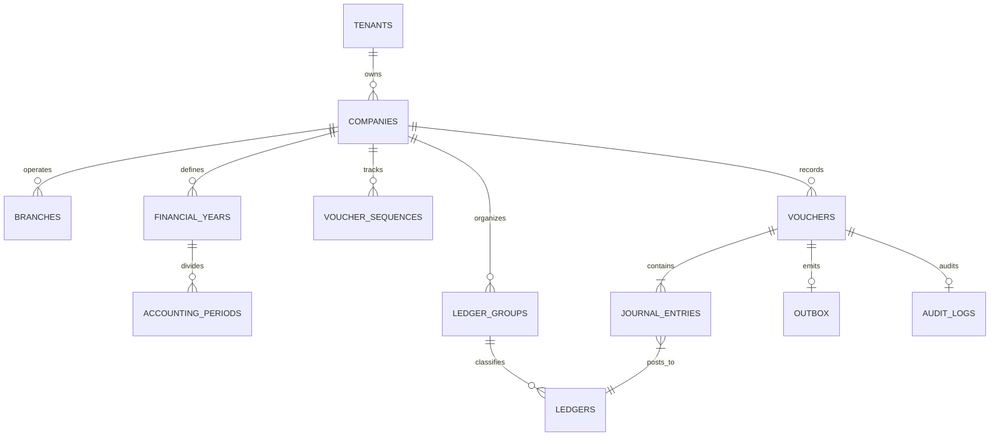

# Phase 0 Implementation Plan: Foundation & Accounting Core

**Phase:** 0 — Foundation & Accounting Core  
**Author:** Principal Software Architect & Senior Full-Stack Engineer  
**Status:** Awaiting Approval  
**Date:** October 2026  

---

## 1. Executive Summary & Objectives

Phase 0 establishes the mission-critical foundation for the entire End-to-End Accounting Platform. Its purpose is to deliver a rock-solid, production-grade technical and domain foundation ensuring that financial data integrity, tenant isolation, concurrency safety, auditability, and deterministic compliance are guaranteed at the lowest architectural and database layers before higher-level modules are introduced.

Even though customer-facing cloud bookkeeping UI expands in Phase 3, **the canonical double-entry accounting engine, database invariants, and multi-tenancy are designed and fully tested in Phase 0**.

---

## 2. Scope & Vertical Slices

The phase is structured into 8 modular vertical slices:

```
[ Slice 1: Monorepo & Tooling ] ──► [ Slice 2: Persistence & Migrations ]
                                                │
[ Slice 4: Multi-Tenancy & RLS ] ◄── [ Slice 3: Canonical Ledger Core ]
         │
         ▼
[ Slice 5: Auth & RBAC Guard ] ──► [ Slice 6: Outbox & BullMQ Worker ]
                                                │
[ Slice 8: Design System & Web ] ◄── [ Slice 7: GST Rules & Pipeline ]
```

1. **Monorepo & Engineering Tooling:** Turborepo + pnpm workspace configuration, strict TypeScript compiler options, ESLint, Prettier, Husky, lint-staged, and GitHub Actions CI.
2. **Local Infrastructure & Docker:** `docker/docker-compose.yml` for PostgreSQL 16 (with custom init scripts), Redis 7.2 (`noeviction`), and MinIO (S3-compatible object store), plus local development scripts.
3. **Canonical Double-Entry Accounting Core (`packages/accounting-core`):** Pure domain model (Voucher, JournalEntry, Ledger, LedgerGroup, Money/Decimal value object). Zero framework dependencies.
4. **PostgreSQL Persistence & Database Invariants:** TypeORM setup with `synchronize: false`. Migration scripts establishing tables and raw SQL deferred constraint triggers for $\sum \text{Debit} = \sum \text{Credit}$, posted entry immutability, and accounting period locks.
5. **Multi-Tenancy & Row-Level Security (RLS):** `Tenant`, `Company`, `Branch` data model. Postgres RLS enabled on all tenant tables via `SET LOCAL app.tenant_id`. Unit-of-Work and `AsyncLocalStorage` tenant context.
6. **Authentication, RBAC & Security:** Short-lived JWT access tokens with rotating refresh cookies, Argon2id password hashing, policy-based guards (`RolesGuard`, `TenantGuard`), and AES-256-GCM column encryption transformers.
7. **Transactional Outbox & BullMQ Worker Pool (`apps/worker`):** Atomic outbox persistence in PostgreSQL, worker dispatcher polling with `FOR UPDATE SKIP LOCKED`, and BullMQ queues with dead-letter queue (DLQ) support.
8. **Deterministic GST Rules Engine (`packages/gst-rules`) & AIE Pipeline:** Place-of-supply resolution, HSN/SAC lookup, tax math, 8-stage pipeline skeleton, and pluggable `AiProvider` interface with mock implementation.
9. **UI Design System Foundation (`packages/ui` & `apps/web`):** Next.js App Router skeleton, Radix UI headless primitives, Tailwind CSS design tokens, Indian currency/number formatting, and WCAG 2.2 AA accessibility foundation.

---

## 3. Data Model & Migrations Specification

All migrations are versioned, reversible, and enforce strict naming strategies (`snake_case`).



### Table Specifications:
1. `tenants`: `id (UUID PK)`, `name`, `slug (UNIQUE)`, `plan`, `created_at`, `updated_at`.
2. `users`: `id (UUID PK)`, `tenant_id (FK)`, `email (UNIQUE)`, `password_hash`, `first_name`, `last_name`, `phone_encrypted`, `is_active`, `mfa_secret_encrypted`, `created_at`.
3. `roles` & `permissions`: RBAC definitions with composite keys.
4. `user_roles`: `user_id`, `role_id`, `tenant_id`, `company_id` (scoped access).
5. `companies`: `id (UUID PK)`, `tenant_id (FK)`, `legal_name`, `trade_name`, `pan_encrypted`, `default_currency (DEFAULT 'INR')`, `is_active`, `created_at`.
6. `branches`: `id (UUID PK)`, `tenant_id (FK)`, `company_id (FK)`, `branch_name`, `gstin`, `state_code (2 digits)`, `address_line1`, `pincode`, `is_head_office`, `created_at`.
7. `financial_years`: `id (UUID PK)`, `tenant_id (FK)`, `company_id (FK)`, `name (e.g. 'FY 2026-27')`, `start_date`, `end_date`, `is_closed`.
8. `accounting_periods`: `id (UUID PK)`, `tenant_id (FK)`, `company_id (FK)`, `financial_year_id (FK)`, `period_name (e.g. 'Apr 2026')`, `start_date`, `end_date`, `is_locked`, `locked_at`, `locked_by`.
9. `ledger_groups`: `id (UUID PK)`, `tenant_id (FK)`, `company_id (FK)`, `parent_group_id (FK nullable)`, `code`, `name`, `nature ('ASSET', 'LIABILITY', 'EQUITY', 'INCOME', 'EXPENSE')`.
10. `ledgers`: `id (UUID PK)`, `tenant_id (FK)`, `company_id (FK)`, `group_id (FK)`, `code`, `name`, `currency`, `opening_balance`, `current_balance`, `is_bank_or_cash`, `is_active`, `created_at`.
11. `voucher_sequences`: `id (UUID PK)`, `tenant_id (FK)`, `company_id (FK)`, `voucher_type`, `series`, `financial_year_id (FK)`, `last_sequence (BIGINT)`, `prefix`, `suffix`, `padding`. Unique index on `(company_id, voucher_type, series, financial_year_id)`.
12. `vouchers`: `id (UUID PK)`, `tenant_id (FK)`, `company_id (FK)`, `branch_id (FK)`, `financial_year_id (FK)`, `voucher_type ('SALES', 'PURCHASE', 'PAYMENT', 'RECEIPT', 'CONTRA', 'JOURNAL', 'CREDIT_NOTE', 'DEBIT_NOTE')`, `voucher_number`, `voucher_date`, `status ('DRAFT', 'POSTED', 'REVERSED', 'CANCELLED')`, `total_amount NUMERIC(20,4)`, `idempotency_key (VARCHAR UK)`, `reversal_of_id (FK nullable)`, `narration`, `version INT`, `created_by`, `created_at`.
13. `journal_entries`: `id (UUID PK)`, `tenant_id (FK)`, `voucher_id (FK)`, `ledger_id (FK)`, `entry_type ('DEBIT', 'CREDIT')`, `amount NUMERIC(20,4)`, `foreign_amount NUMERIC(20,4) NULL`, `currency`, `narration`, `line_index INT`.
14. `outbox`: `id (UUID PK)`, `tenant_id (FK)`, `aggregate_type`, `aggregate_id`, `event_type`, `payload (JSONB)`, `status ('PENDING', 'PROCESSING', 'PUBLISHED', 'FAILED')`, `retry_count INT`, `error_message TEXT`, `created_at`, `published_at`.
15. `audit_logs`: `id (UUID PK)`, `tenant_id (FK)`, `company_id (FK)`, `actor_id (FK)`, `entity_type`, `entity_id`, `action ('CREATE', 'UPDATE', 'DELETE', 'POST', 'REVERSE', 'LOCK')`, `payload_before (JSONB)`, `payload_after (JSONB)`, `record_hash (CHAR(64))`, `created_at`.

### Database Invariants via Raw SQL (Inside Initial Migration):
1. **Deferred Balancing Constraint Trigger on `journal_entries`:** Checks that $\sum \text{Debit} = \sum \text{Credit}$ per voucher when the transaction commits.
2. **Posted Voucher Immutability Trigger on `vouchers` & `journal_entries`:** Blocks `UPDATE` and `DELETE` on records where `status = 'POSTED'`.
3. **Period Lock Trigger on `vouchers`:** Checks `accounting_periods` for the `voucher_date` and forbids insert/update if `is_locked = TRUE`.
4. **Row-Level Security Policies:** Enabled and forced on all tenant tables using `tenant_id = NULLIF(current_setting('app.tenant_id', true), '')::uuid`.

---

## 4. Queues & Background Jobs Architecture

- **Redis Instance:** Configured with `maxmemory-policy noeviction`.
- **BullMQ Queues in `apps/worker`:**
  1. `queue.outbox.dispatch`: Reads pending outbox entries with `FOR UPDATE SKIP LOCKED` and publishes to domain queues.
  2. `queue.audit.persist`: Processes asynchronous audit hashes and archive records.
  3. `queue.system.health`: Periodic ping verifying Redis and PostgreSQL connection health.
- **Job Reliability Strategy:**
  - Backoff: Exponential backoff with jitter ($1\text{s}, 5\text{s}, 25\text{s}$).
  - DLQ: Failed jobs persist to `failed_jobs` table after 5 retries.
  - Job idempotency: `jobId` derived from `outbox.id`.

---

## 5. API Endpoints Specification (`/v1`)

All endpoints return a standardized JSON response envelope `{ success: boolean, data?: T, error?: ErrorEnvelope, meta?: PaginationMeta }`.

### 5.1 Identity & Access
- `POST /v1/auth/register` — Register tenant & root user.
- `POST /v1/auth/login` — Authenticate, return access token, set refresh cookie.
- `POST /v1/auth/refresh` — Rotate refresh token, issue new access token.
- `POST /v1/auth/logout` — Revoke refresh token and clear cookie.
- `GET /v1/auth/me` — Current user profile, roles, and accessible companies.

### 5.2 Tenancy & Companies
- `POST /v1/companies` — Create company under tenant.
- `GET /v1/companies` — List accessible companies.
- `GET /v1/companies/:id` — Company details, branches, and financial years.
- `POST /v1/companies/:id/branches` — Add branch with GSTIN.
- `POST /v1/companies/:id/periods/lock` — Lock an accounting period.

### 5.3 Chart of Accounts
- `POST /v1/companies/:id/ledger-groups` — Create hierarchical ledger group.
- `GET /v1/companies/:id/ledger-groups` — Fetch ledger group tree.
- `POST /v1/companies/:id/ledgers` — Create ledger under a group.
- `GET /v1/companies/:id/ledgers` — List ledgers with current balances.

### 5.4 Canonical Voucher Engine
- `POST /v1/companies/:id/vouchers` — Create and post a balanced double-entry voucher (supports idempotency header `X-Idempotency-Key`).
- `GET /v1/companies/:id/vouchers` — Paginated list of vouchers with filtering (type, date range, status).
- `GET /v1/companies/:id/vouchers/:voucherId` — Single voucher with journal entry lines and audit history.
- `POST /v1/companies/:id/vouchers/:voucherId/reverse` — Issue a full reversal voucher with cross-referencing.

### 5.5 System & Diagnostic
- `GET /v1/health` — Liveness & readiness probes (PostgreSQL, Redis, Outbox lag).

---

## 6. Frontend & UI Screens (`apps/web` & `packages/ui`)

- **Design System Tokens (`packages/ui`):** Colors (neutral, brand, success, warning, destructive), spacing (8px grid), typography, border radius, and elevation shadows.
- **Accessible Headless Components (`packages/ui`):** Button, Input, Select, Dialog/Modal, Toast/Alert, Table, Badge, DropdownMenu, Tabs, Skeleton.
- **Application Shell (`apps/web`):**
  - Navigation sidebar with tenant and company switcher.
  - Light/Dark mode toggle (Tailwind tokens).
  - Indian currency and number formatting utilities (Lakhs/Crores display).
  - Initial screens:
    1. `/login` & `/register` authentication flows.
    2. `/dashboard` overview shell with system health cards.
    3. `/ledgers` chart of accounts tree view.
    4. `/vouchers` voucher list and interactive double-entry posting form with dynamic debit/credit balancing indicator.

---

## 7. Comprehensive Test Plan

Every vertical slice must pass automated tests before moving forward:

1. **Unit Tests (`packages/accounting-core` & `packages/gst-rules`):**
   - Pure domain voucher validation tests.
   - Fast-check property-based tests: 1,000 generated randomized balanced vouchers must satisfy $\sum \text{Debit} = \sum \text{Credit}$.
   - Decimal rounding and tax calculation tests.
   - Deterministic GST Place of Supply rules (Intra vs. Inter-state, SEZ, exports).
2. **Database Invariant Tests (PostgreSQL via Testcontainers):**
   - Test inserting an unbalanced voucher $\rightarrow$ verify deferred constraint trigger throws exception.
   - Test updating or deleting a `POSTED` voucher $\rightarrow$ verify immutability trigger blocks action.
   - Test inserting a voucher into a locked accounting period $\rightarrow$ verify period lock trigger blocks action.
   - Test inserting duplicate `idempotency_key` $\rightarrow$ verify unique index error.
3. **Multi-Tenancy & RLS Integration Tests:**
   - Seed Tenant A and Tenant B with distinct companies and vouchers.
   - Connect as Tenant A $\rightarrow$ query vouchers $\rightarrow$ assert Tenant B vouchers are completely invisible.
   - Attempt direct SQL query without `SET LOCAL app.tenant_id` $\rightarrow$ assert 0 rows returned.
4. **Transactional Outbox & Worker Integration Tests:**
   - Post voucher $\rightarrow$ verify outbox event created in the same transaction.
   - Worker polls outbox $\rightarrow$ dispatches to BullMQ $\rightarrow$ status updates to `PUBLISHED`.
5. **Migration Rollback Tests:**
   - Run `typeorm migration:run` on clean database $\rightarrow$ verify schema.
   - Run `typeorm migration:revert` $\rightarrow$ verify clean teardown.
   - Run `typeorm migration:run` again $\rightarrow$ verify idempotency of migrations.

---

## 8. Risks & Mitigations

| Risk | Impact | Mitigation Strategy |
|---|---|---|
| Deferred constraint trigger performance on bulk inserts | Slower batch import processing | Trigger is optimized with index on `journal_entries(voucher_id)`; bulk batch vouchers are chunked in batches of 500. |
| RLS connection pooling leakage in NestJS | Cross-tenant data bleed | Every query runner in the Unit-of-Work sets `SET LOCAL app.tenant_id` within the active transaction; transactions are strictly reset upon release to the pool. |
| Monorepo dependency cycle between domain and persistence | Architecture degradation | `dependency-cruiser` CI rules fail the build if `packages/accounting-core` imports TypeORM or `apps/*`. |

---

## 9. Phase 0 Release Gate Checklist

To satisfy the Definition of Done for Phase 0:
- [ ] Monorepo build, lint, and TypeScript checks pass cleanly with zero warnings or `any` types.
- [ ] Database migrations execute cleanly up and down.
- [ ] Database triggers successfully reject unbalanced vouchers, mutations to posted vouchers, and locked-period postings.
- [ ] Row-Level Security tests prove cross-tenant access is impossible.
- [ ] Unit-of-Work guarantees atomic voucher + entries + outbox + audit commit.
- [ ] Outbox processor successfully delivers events to BullMQ.
- [ ] `packages/gst-rules` satisfies 100% of Place of Supply and tax math test cases.
- [ ] Design system tokens and baseline UI components render cleanly in `apps/web`.
- [ ] CI workflow runs all tests in GitHub Actions and passes.

---

*Awaiting user approval to proceed with Phase 0 execution.*

