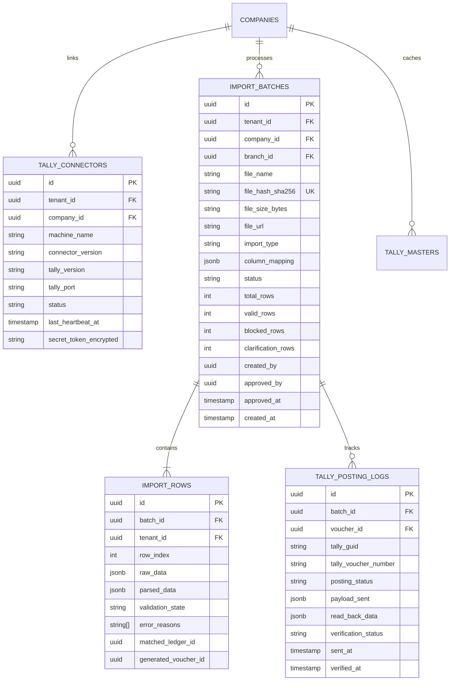

# Phase 1 Implementation Plan: Tally Entry Integrity & Bulk Import Wizard

**Phase:** 1 — Tally Entry Integrity & Bulk Import Wizard  
**Author:** Principal Software Architect & Senior Full-Stack Engineer  
**Status:** Awaiting Approval  
**Date:** October 2026  

---

## 1. Executive Summary & Commercial Objective

Phase 1 delivers the **first commercial beachhead workflow** for the platform: enabling accounting practitioners, CAs, and business bookkeepers to import high-volume Excel, CSV, and PDF registers, run them through deterministic GST and accounting validation, resolve exceptions in an interactive visual workspace, submit verified vouchers to Tally via a secure connector, and execute **read-back verification** to guarantee zero duplicate or corrupted vouchers in Tally.

The frontend is designed with **Stripe/Mercury-grade visual polish**: step-by-step interactive stepper, drag-and-drop file upload with animated file preview, column auto-mapping pill selectors, data-dense virtualized exception tables, and real-time connector heartbeat status.

---

## 2. Phase 1 Scope & Vertical Slices

```
[ Slice 1: Import Engine & Staging Tables ] ──► [ Slice 2: Column Mapper & Schema Inference ]
                                                              │
[ Slice 4: Pre-Import Exception Engine ] ◄── [ Slice 3: Master Sync & Fuzzy Matcher ]
         │
         ▼
[ Slice 5: Tally Connector Bridge Gateway ] ──► [ Slice 6: Read-Back Verification Protocol ]
                                                              │
[ Slice 8: Enterprise UI Experience ] ◄── [ Slice 7: Maker-Checker Sign-off ]
```

1. **Universal File Ingestion & Deduplication:** Support `.xlsx`, `.csv`, `.tsv`, and tabular `.pdf`. Compute SHA-256 content hashes to detect and block accidental duplicate file uploads.
2. **Interactive Column Mapping Wizard:** Heuristic auto-detection of common column headers (Invoice No, Date, Customer/Vendor, GSTIN, HSN, Taxable Value, CGST, SGST, IGST, Total). Visual mapping UI with live sample row preview.
3. **Master Data Sync & Fuzzy Matching:** Synchronize Tally ledgers, ledger groups, and voucher types. Levenshtein / Jaro-Winkler fuzzy matching for party names with similarity threshold $\ge 0.85$.
4. **Pre-Import Exception Resolution Engine:** Categorize every imported row into:
   - `GREEN (Ready to Post)`: All required fields valid, masters matched, tax math verified.
   - `YELLOW (Clarification)`: Missing ledger or new customer, suggested matching available.
   - `RED (Blocked)`: Invalid GSTIN checksum, mismatched place of supply, mathematical discrepancy.
   - `BLUE (Pending Approval)`: High-value transactions requiring manager sign-off.
5. **In-Place Bulk Fixer:** Allow accountants to edit invalid HSNs, correct GST rates, or map missing ledgers in bulk with a single click.
6. **Windows Tally Connector Gateway:** Outbound WebSocket / HTTPS polling communication bridge. Translates canonical vouchers into Tally XML format (Tally Daybook Envelope).
7. **Read-Back Verification Protocol:** Reads back the committed voucher from Tally via XML request, asserts byte-and-field equivalence with cloud voucher, and prevents blind retries on network timeouts (`UNCERTAIN` state machine).
8. **Maker-Checker Authorization:** Enforces dual control for batch imports exceeding configurable thresholds.
9. **Commercial-Grade UI Screens (`apps/web`):**
   - `/imports` — Import batch history, status tags, and error metrics.
   - `/imports/new` — Guided 5-step import wizard with drag-and-drop file ingestion.
   - `/imports/[id]/review` — Pre-import exception cockpit with tabbed filters (`All`, `Ready`, `Blocked`, `Needs Master`) and bulk action bar.
   - `/settings/tally` — Live Tally connector health card, latency monitor, and company discovery.

---

## 3. Data Model & Migration Changes



### New Tables Specification:
1. `tally_connectors`: Tracks client Windows machines running the local bridge. Stores machine identifier, Tally version (TallyPrime 1.0–4.1), heartbeat timestamp, and AES-256 encrypted authentication tokens.
2. `import_batches`: Ingestion session tracking with file hash deduplication (`UNIQUE(tenant_id, company_id, file_hash_sha256)`), column mapping JSONB, progress indicators, and approval status (`UPLOADED`, `MAPPING`, `VALIDATING`, `READY_FOR_APPROVAL`, `APPROVED`, `POSTING`, `COMPLETED`, `FAILED`).
3. `import_rows`: Staging table containing individual parsed lines, validation state (`GREEN`, `YELLOW`, `RED`, `BLUE`), error diagnostic array, and foreign key to generated canonical voucher.
4. `tally_masters`: Cached snapshot of Tally ledgers and groups synchronized from the connected machine for ultra-fast local validation.
5. `tally_posting_logs`: Audit and read-back record capturing raw XML payloads sent to Tally, Tally response GUID, read-back XML response, and field comparison result.

---

## 4. Queues & Background Jobs Architecture

- **`queue.import.process`:** Worker job parsing high-volume Excel/CSV/PDF files (up to 50,000 rows) into `import_rows` in background chunks of 500 records.
- **`queue.import.validate`:** Runs batch validation through `@platform/gst-rules` and `@platform/accounting-core`.
- **`queue.tally.sync`:** Dispatches batches of validated vouchers to the WebSocket gateway for delivery to the Windows connector.
- **`queue.tally.readback`:** Triggered after voucher submission to query Tally daybook and compare the committed voucher with the cloud record.

---

## 5. API Endpoints Specification (`/v1`)

### 5.1 Import Ingestion & Mapping
- `POST /v1/companies/:companyId/imports/upload` — Ingest Excel/CSV file, compute SHA-256 hash, detect headers, return detected columns and batch ID.
- `POST /v1/companies/:companyId/imports/:batchId/map` — Save column mappings and trigger background validation worker.
- `GET /v1/companies/:companyId/imports/:batchId` — Fetch batch summary, progress percentage, and validation counters (Valid, Blocked, Clarification).
- `GET /v1/companies/:companyId/imports/:batchId/rows` — Virtualized paginated list of rows with status filter (`status=RED`, `status=GREEN`).
- `PATCH /v1/companies/:companyId/imports/:batchId/rows/bulk-fix` — Bulk update missing ledger mappings or tax rates across selected rows.
- `POST /v1/companies/:companyId/imports/:batchId/approve` — Maker-Checker sign-off to authorize posting.

### 5.2 Tally Connector & Synchronization
- `GET /v1/companies/:companyId/tally/connector` — Live connector status, heartbeat, and active Tally company name.
- `POST /v1/companies/:companyId/tally/sync-masters` — Request on-demand master synchronization from connected Tally.
- `POST /v1/companies/:companyId/imports/:batchId/post-to-tally` — Enqueue batch posting to Tally with read-back verification.

---

## 6. Frontend UI / UX Specification (Commercial Polish)

1. **Step-by-Step Import Stepper (`/imports/new`):**
   - **Step 1: Upload:** Drag-and-drop zone with format badges (`.xlsx`, `.csv`), file size limit indicator, and animated upload progress bar.
   - **Step 2: Map Columns:** Two-column visual mapper showing Source File Headers vs. Canonical Target Fields (Invoice No, Date, Customer, Taxable Value, GSTIN, HSN). Includes auto-suggest button and live 3-row preview.
   - **Step 3: Validation Cockpit:** Instant breakdown cards (e.g. `240 Ready to Post`, `12 Missing Ledgers`, `3 Invalid GSTINs`).
   - **Step 4: Exception Resolution:** Interactive grid with editable cells for quick corrections. "Create All Missing Ledgers" button.
   - **Step 5: Review & Post:** Final confirmation card showing total debits, total credits, GST tax breakdown, and posting target (Tally or Cloud).
2. **Connector Monitor Dashboard (`/settings/tally`):**
   - Animated pulse indicator (Green: Connected, Amber: Syncing, Red: Offline).
   - Tally version, port 9000 ping latency, and connected company badge.
   - One-click "Download Windows Connector (.exe / .msi)" button.

---

## 7. Test Plan & Release Gate 1 Verification

1. **Golden Dataset Import Tests:**
   - Test files: Sales register with 1,000 rows (including 50 malformed GSTINs, 20 missing ledgers, 10 inverted dates).
   - Verify that 100% of invalid rows are correctly intercepted and marked `RED` or `YELLOW`.
2. **Duplicate Ingestion Prevention:**
   - Upload identical Excel file twice $\rightarrow$ verify 409 Conflict with clear diagnostic message citing earlier batch ID.
3. **Read-Back Verification Protocol Test:**
   - Simulate successful Tally write $\rightarrow$ read-back matches $\rightarrow$ voucher marked `VERIFIED`.
   - Simulate network timeout mid-flight $\rightarrow$ status transitions to `UNCERTAIN` $\rightarrow$ Daybook inspection triggers before any retry.
   - Simulate mismatched amount in Tally $\rightarrow$ marks discrepancy error and alerts reviewer.
4. **End-to-End E2E Journey:**
   - Upload file -> Map columns -> Resolve 1 exception -> Approve -> Generate canonical vouchers -> Verify balanced ledger state.

---

## 8. Definition of Done for Phase 1

- [ ] Import wizard parses Excel, CSV, and tabular PDF files without memory leaks.
- [ ] Duplicate file detection via SHA-256 blocks redundant imports.
- [ ] Pre-import exception cockpit allows in-place resolution of missing ledgers and tax errors.
- [ ] Tally connector XML generator formats valid Tally Daybook envelopes.
- [ ] Read-back verification protocol guarantees zero duplicate vouchers on network dropouts.
- [ ] UI satisfies WCAG 2.2 AA accessibility and responsive design tokens.
- [ ] Full automated test suite passes with $\ge 90\%$ test coverage on new modules.

---

*Awaiting user approval of Phase 1 Plan to initiate implementation.*

