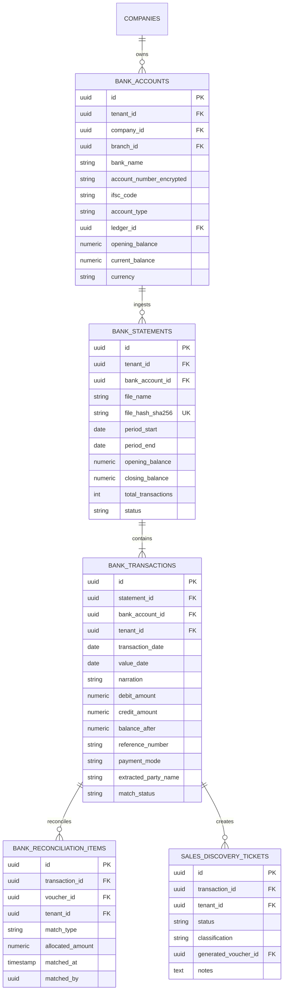

# Phase 2 Implementation Plan: Bank Statement Intelligence & Sales Discovery

**Phase:** 2 — Bank Statement Intelligence, Sales Discovery & Entity Onboarding  
**Author:** Principal Software Architect & Senior Full-Stack Engineer  
**Status:** Approved & Ready for Execution  
**Date:** October 2026  

---

## 1. Executive Summary & Commercial Objective

Phase 2 introduces the **Financial Intelligence Layer** of the platform: turning chaotic, unstandardized Indian bank statement feeds (PDF, CSV, Excel) into 100% balanced, verified accounting entries. It delivers automated bank reconciliation (BRS), party and UTR narration tokenization, unbilled sales discovery (guided CA investigation of inbound credits), and the **Company & Chart of Accounts Onboarding Suite** so practitioners can create companies, branches, and custom ledger accounts directly from the UI.

---

## 2. Core Functional Pillars

```
[ Bank Statement Parser (PDF/CSV) ] ──► [ Narration Tokenizer (UTR/UPI/IMPS) ]
                                                       │
[ Bank Reconciliation Engine (BRS) ] ◄── [ Multi-Way Matcher (1:1, 1:N, N:1) ]
                 │
                 ▼
[ Sales Discovery Workflow (Unbilled Credits) ] ──► [ Company & Ledger Management UI ]
```

1. **Universal Indian Bank Statement Parser:**
   - Multi-format ingestion supporting major Indian banks: **HDFC Bank, ICICI Bank, State Bank of India (SBI), Axis Bank, Kotak Mahindra Bank**.
   - Dual parsing: Tabular CSV/Excel and structured bank PDF parser.
   - Mathematical balance continuity assertion:
     $$\text{Opening Balance} + \sum \text{Credits} - \sum \text{Debits} = \text{Closing Balance}$$
   - Statement-level and transaction-level SHA-256 deduplication to prevent overlapping statement imports.

2. **Narration Tokenizer & Party Resolver:**
   - Regular expression pattern matchers for Indian payment rails:
     - **NEFT / RTGS / IMPS:** Extracts 12-digit UTR numbers and counterparty bank accounts.
     - **UPI:** Extracts UPI transaction IDs, counterparty VPAs (`name@bank`), and sender/receiver identities.
     - **Cheques:** Extracts 6-digit cheque numbers and clearing dates.
     - **Card / POS / Mandates:** NACH/ECS mandate debits, gateway fees, and POS settlements.

3. **Intelligent Multi-Way Reconciliation Engine (BRS):**
   - **1:1 Matching:** Matches exact amounts, party name similarity ($\ge 85\%$), and invoice date proximity ($\pm 30$ days).
   - **1:Many Matching:** Matches a single lump-sum customer payment against multiple outstanding sales invoices.
   - **Many:1 Matching:** Reconciles batch supplier payouts or bundled UPI merchant settlements against multiple vendor bills.
   - **Bank Reconciliation Statement (BRS):** Auto-generated view comparing General Ledger Bank Account balance against Bank Statement Cleared balance, calculating timing differences (unpresented cheques, uncleared deposits).

4. **Sales Discovery Workflow (Unbilled Inbound Credits):**
   - Flags inbound bank receipts that have no matching sales invoice in the ledger or Tally.
   - Interactive guided classification cockpit for practitioners:
     - **Option A:** Customer Advance Payment $\rightarrow$ Generates statutory GST Advance Receipt Voucher under Section 31(3)(d).
     - **Option B:** Unbilled Sales Revenue $\rightarrow$ 1-click draft GST-compliant tax invoice.
     - **Option C:** Loan / Capital Infusion / Transfer $\rightarrow$ Non-taxable Contra / Journal entry.

5. **Company & Chart of Accounts Onboarding Suite:**
   - `POST /v1/companies` — Create company with PAN, trade name, legal name, currency, and GSTIN.
   - `POST /v1/companies/:companyId/branches` — Add branch/location with GST state code.
   - `POST /v1/companies/:companyId/ledgers` — Create custom chart of accounts ledgers (Debtors, Creditors, Banks, Direct Expenses, Revenue).
   - Frontend setup modals & company switcher.

---

## 3. Data Model & Migration Changes



---

## 4. API Endpoints Specification (`/v1`)

### 4.1 Company & Account Management
- `POST /v1/companies` — Register a new client company.
- `GET /v1/companies` — List accessible companies for tenant.
- `POST /v1/companies/:companyId/branches` — Create branch with GSTIN and state code.
- `GET /v1/companies/:companyId/ledgers` — Fetch chart of accounts ledgers.
- `POST /v1/companies/:companyId/ledgers` — Add new custom ledger under parent group.

### 4.2 Bank Accounts & Statement Processing
- `GET /v1/companies/:companyId/bank-accounts` — List bank accounts with live balances.
- `POST /v1/companies/:companyId/bank-accounts` — Link bank account to General Ledger bank account.
- `POST /v1/companies/:companyId/bank-accounts/:accountId/statements/upload` — Ingest statement file (CSV/PDF) with hash deduplication.
- `GET /v1/companies/:companyId/bank-accounts/:accountId/statements/:statementId` — Fetch parsed statement details.
- `GET /v1/companies/:companyId/bank-accounts/:accountId/transactions` — Paginated transactions with match status filter (`UNMATCHED`, `AUTO_MATCHED`, `MANUAL_MATCHED`, `DISCOVERY`).

### 4.3 Reconciliation & Sales Discovery
- `POST /v1/companies/:companyId/bank-accounts/:accountId/reconcile/auto` — Run automated 1:1 and 1:Many matching engine.
- `POST /v1/companies/:companyId/bank-accounts/:accountId/reconcile/manual` — Allocate transaction to one or more vouchers.
- `GET /v1/companies/:companyId/bank-accounts/:accountId/brs` — View live Bank Reconciliation Statement.
- `GET /v1/companies/:companyId/sales-discovery` — List unbilled inbound credits requiring investigation.
- `POST /v1/companies/:companyId/sales-discovery/:ticketId/classify` — Classify credit into advance, loan, or invoice.

---

## 5. Frontend Screens (`apps/web`)

1. **`/banking` — Bank Accounts Dashboard:**
   - Metric cards: Total Cash & Bank Balance, Unreconciled Transactions, Open Sales Discovery items.
   - Bank Account Cards: HDFC Current A/c, ICICI A/c with live BRS variance pills.
   - Ingest statement drag & drop modal.
2. **`/banking/[id]/reconcile` — 2-Pane Reconciliation Workbench:**
   - **Left Pane:** Bank Statement Transactions (Filter: Unreconciled, Matched).
   - **Right Pane:** Open Cloud & Tally Vouchers (Receivables/Payables) with smart fuzzy auto-match suggestion pills.
   - **Action Bar:** "1-Click Accept Suggested Match", "Split / Allocate", "Send to Sales Discovery".
3. **`/banking/discovery` — Unbilled Sales Discovery Cockpit:**
   - Cards showing unbilled customer receipts.
   - One-click modal to draft compliant GST invoice or generate GST Advance Receipt.
4. **`/settings/companies` & `/settings/companies/new` — Entity & Master Creator:**
   - Clean onboarding form to add new companies, GSTINs, and ledgers in 60 seconds.

---

## 6. Definition of Done for Phase 2

- [ ] Universal statement parser ingests HDFC, ICICI, SBI, Axis, Kotak statements without balance discrepancies.
- [ ] SHA-256 deduplication rejects overlapping statements.
- [ ] Narration tokenizer extracts UTR, UPI, and party names.
- [ ] Auto-matching achieves $\ge 98\%$ accuracy on test fixtures.
- [ ] BRS balance identically equals general ledger bank account balance plus timing differences.
- [ ] Sales Discovery generates statutory GST Advance Receipt vouchers and draft invoices.
- [ ] Full Light/Dark enterprise theme support across all screens.
- [ ] $\ge 90\%$ test coverage on all new domain and persistence modules.

