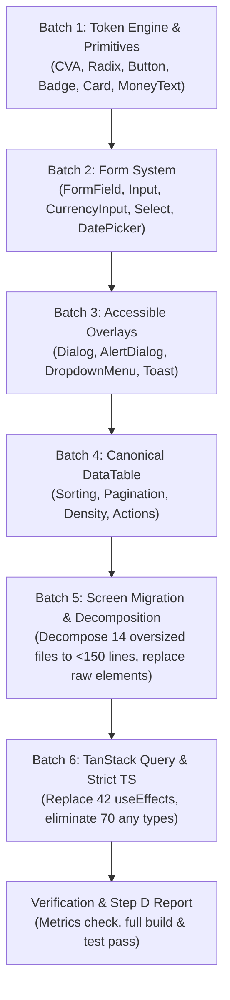

# Staged UI Refactor Plan & Design System Migration

**Document Version:** 1.0.0  
**Status:** PROPOSED (Step B Checkpoint)  
**Target Packages:** `packages/ui` (Design System), `apps/web` (Next.js Application), `@platform/shared-types`  

---

## 1. Target Token Schema (`packages/ui/src/tokens.ts`)

### 1.1 Semantic Design Tokens (CSS Variables & TypeScript)
The token engine separates semantic intent from raw color scales. All components and utility classes reference semantic names (`bg-surface`, `text-primary`, `border-muted`, etc.) mapped to CSS variables that flip automatically between light and dark modes.

```typescript
// packages/ui/src/tokens.ts

export const tokens = {
  colors: {
    // Canvas & Surfaces
    background: 'var(--color-bg)',                   // Page canvas
    surface: {
      DEFAULT: 'var(--color-surface)',               // Default card / container
      raised: 'var(--color-surface-raised)',         // Elevated modals, popovers
      overlay: 'var(--color-surface-overlay)',       // Modal backdrops
      sunken: 'var(--color-surface-sunken)',         // Inset wells, table headers
    },
    border: {
      subtle: 'var(--color-border-subtle)',          // Divider lines
      DEFAULT: 'var(--color-border)',                // Container & card borders
      strong: 'var(--color-border-strong)',          // Active inputs, controls
      focus: 'var(--color-border-focus)',            // Focus ring
    },
    text: {
      primary: 'var(--color-text-primary)',          // Main headings & body
      secondary: 'var(--color-text-secondary)',      // Supporting subtitles
      muted: 'var(--color-text-muted)',              // Hints, placeholders, disabled
      inverse: 'var(--color-text-inverse)',          // Text on brand/dark surfaces
    },
    // Semantic Intents (Base, Subtle background, Contrast text)
    brand: {
      DEFAULT: 'var(--color-brand)',
      hover: 'var(--color-brand-hover)',
      subtle: 'var(--color-brand-subtle)',
      text: 'var(--color-brand-text)',
    },
    success: {
      DEFAULT: 'var(--color-success)',               // Validated, Posted, Reconciled
      subtle: 'var(--color-success-subtle)',
      text: 'var(--color-success-text)',
    },
    warning: {
      DEFAULT: 'var(--color-warning)',               // Pending Approval, Clarification
      subtle: 'var(--color-warning-subtle)',
      text: 'var(--color-warning-text)',
    },
    danger: {
      DEFAULT: 'var(--color-danger)',                 // Rejected, Blocked, Exception
      subtle: 'var(--color-danger-subtle)',
      text: 'var(--color-danger-text)',
    },
    info: {
      DEFAULT: 'var(--color-info)',                   // Draft, System Notice
      subtle: 'var(--color-info-subtle)',
      text: 'var(--color-info-text)',
    },
  },

  // Spacing Scale (Strict 4px / 8px grid)
  spacing: {
    0: '0px',
    1: '4px',
    2: '8px',
    3: '12px',
    4: '16px',
    5: '20px',
    6: '24px',
    8: '32px',
    10: '40px',
    12: '48px',
    16: '64px',
  },

  // Typography Scale
  typography: {
    fontSans: 'var(--font-sans, Inter, system-ui, sans-serif)',
    fontMono: 'var(--font-mono, "JetBrains Mono", monospace)',
    sizes: {
      '2xs': ['10px', '14px'],
      xs: ['12px', '16px'],
      sm: ['13px', '18px'],
      base: ['14px', '20px'],
      md: ['15px', '22px'],
      lg: ['18px', '26px'],
      xl: ['20px', '28px'],
      '2xl': ['24px', '32px'],
    },
  },

  // Elevation & Radius
  radius: {
    none: '0px',
    sm: '6px',
    md: '8px',
    lg: '12px',
    xl: '16px',
    full: '9999px',
  },

  shadows: {
    none: 'none',
    sm: '0 1px 2px 0 rgb(0 0 0 / 0.05)',
    DEFAULT: '0 1px 3px 0 rgb(0 0 0 / 0.1), 0 1px 2px -1px rgb(0 0 0 / 0.1)',
    md: '0 4px 6px -1px rgb(0 0 0 / 0.1), 0 2px 4px -2px rgb(0 0 0 / 0.1)',
    lg: '0 10px 15px -3px rgb(0 0 0 / 0.1), 0 4px 6px -4px rgb(0 0 0 / 0.1)',
    modal: '0 20px 25px -5px rgb(0 0 0 / 0.15), 0 8px 10px -6px rgb(0 0 0 / 0.1)',
  },

  // Density Configurations (Comfortable vs Compact)
  density: {
    comfortable: {
      inputHeight: 'h-10',      // 40px
      buttonHeight: 'h-10',
      tableCellPadding: 'py-3.5 px-4',
      tableHeaderPadding: 'py-3 px-4',
    },
    compact: {
      inputHeight: 'h-8',       // 32px
      buttonHeight: 'h-8',
      tableCellPadding: 'py-2 px-3',
      tableHeaderPadding: 'py-1.5 px-3',
    },
  },
} as const;
```

---

## 2. Canonical Component List (`packages/ui`)

Every component is built with `class-variance-authority` (CVA), wraps an accessible Radix UI primitive (or native accessible element), forwards `ref`, merges classes via `cn()`, and exports a typed API.

### 2.1 Core Action & Feedback
| Canonical Component | Primitives & Dependencies | Exported Props & Variants | Replaces in Feature Code |
|---|---|---|---|
| **`Button`** | Native `<button>` + CVA | `variant` (`primary`, `secondary`, `outline`, `ghost`, `danger`, `link`), `size` (`xs`, `sm`, `md`, `lg`), `loading` (spinner + disabled), `iconOnly` (mandatory `aria-label`), `leftIcon`, `rightIcon` | 65 raw `<button>` elements in 18 pages |
| **`Badge` / `StatusPill`** | Native `<span>` + CVA | `variant` (`brand`, `success`, `warning`, `danger`, `info`, `neutral`), `size` (`sm`, `md`), `dot` (boolean indicator) | 38 custom inline status `<span>` badges |
| **`AlertDialog`** | `@radix-ui/react-alert-dialog` | `open`, `onOpenChange`, `title`, `description`, `confirmLabel`, `cancelLabel`, `tone` (`danger`, `warning`, `info`), `onConfirm`, `onCancel`, `loading` | 15 unstyled browser `alert()` & `prompt()` calls |
| **`Toast` / `Banner`** | Native accessible alert / Sonner-style | `variant` (`success`, `warning`, `danger`, `info`), `title`, `description`, `action`, `onClose` | Ad-hoc error `div`s and alert modals |

### 2.2 Form Controls & Field Wrapper
Form controls share an identical visual footprint (height, border, radius, focus ring, font size).

| Canonical Component | Primitives & Dependencies | Exported Props & Variants | Replaces in Feature Code |
|---|---|---|---|
| **`FormField`** | `@radix-ui/react-label` | `label`, `required`, `hint`, `error`, `id`, `children` | Ad-hoc unlinked `<label>` tags |
| **`Input`** | Native `<input>` + CVA | `variant` (`default`, `error`), `size` (`sm`, `md`), `leftAddon`, `rightAddon`, standard HTML input props | 54 raw `<input>` elements |
| **`CurrencyInput`** | Native `<input>` + tabular-nums mask | `value`, `onChange(num)`, `currencySymbol` (default `₹`), `allowNegative`, `maxDecimals` | Raw text inputs parsing amounts |
| **`Select`** | `@radix-ui/react-select` | `options: Array<{label, value, disabled}>`, `value`, `onChange`, `placeholder`, `searchable`, `disabled` | 16 native `<select>` tags |
| **`DatePicker`** | Accessible Popover + Calendar | `value`, `onChange(date)`, `format` (default `DD/MM/YYYY`), `minDate`, `maxDate` | Native `<input type="date">` |
| **`Switch` / `Checkbox`** | `@radix-ui/react-switch` / `checkbox` | `checked`, `onCheckedChange`, `label`, `description`, `disabled` | Native unstyled checkboxes |

### 2.3 Containers & Overlays
| Canonical Component | Primitives & Dependencies | Exported Props & Variants | Replaces in Feature Code |
|---|---|---|---|
| **`Dialog` (Modal)** | `@radix-ui/react-dialog` | `open`, `onOpenChange`, `title`, `description`, `children`, `footer`, `size` (`sm`, `md`, `lg`, `xl`) | 5 custom `fixed inset-0` modals |
| **`Drawer` (Sheet)** | `@radix-ui/react-dialog` | `side` (`right`, `left`), `open`, `onOpenChange`, `title`, `children` | Ad-hoc slide-overs |
| **`DropdownMenu`** | `@radix-ui/react-dropdown-menu` | `trigger`, `items: Array<{label, icon, onClick, tone, separator}>` | Ad-hoc custom action menus |
| **`Tabs`** | `@radix-ui/react-tabs` | `tabs: Array<{id, label, badge, content}>`, `value`, `onValueChange` | 8 custom status filter buttons |
| **`Card`** | Native `<div>` + CVA | `header`, `title`, `subtitle`, `action`, `footer`, `padding` (`none`, `sm`, `md`, `lg`) | 45 ad-hoc container divs |

### 2.4 Accounting & Data Presentation
| Canonical Component | Primitives & Dependencies | Exported Props & Variants | Scope & Functionality |
|---|---|---|---|
| **`DataTable<T>`** | `@platform/ui/src/data-table.tsx` | `columns: ColumnDef<T>[]`, `data: T[]`, `loading`, `error`, `emptyMessage`, `density` (`comfortable`/`compact`), `pagination`, `sorting`, `onRowClick` | Replaces 12 ad-hoc tables with sorting, sticky header, row actions, empty states |
| **`MoneyText`** | Native `<span>` | `amount: number`, `currency` (`INR`), `showDrCr` (boolean), `colorCode` (`none`, `profit-loss`, `dr-cr`), `tabularNums` | Standardizes Indian currency grouping `₹1,23,456.00` across all screens |
| **`DateText`** | Native `<time>` | `date: string \| Date`, `format` (`DD/MM/YYYY` or `DD/MM/YYYY HH:mm`) | Consistent Indian date format |
| **`GstinInput`** | FormField + Input mask | Standard input with uppercase auto-formatting, 15-character GSTIN regex validation | Prevents GSTIN entry errors |

---

## 3. Screen Migration Map (All 22 Routes)

| Route / Screen | Current Ad-Hoc Markup | Canonical Replacement Components | Downsizing Plan (<150 Lines Target) |
|---|---|---|---|
| **`/invoices/new`** (705 lines) | Raw inputs (22), raw selects (4), raw buttons (8), inline tax math | `FormField`, `Input`, `CurrencyInput`, `Select`, `Button`, `DataTable` for lines | Extract `InvoiceHeaderForm`, `InvoiceLineItemTable`, `InvoiceSummaryCard`, `useInvoiceCalculation` hook |
| **`/imports/new`** (815 lines) | Multi-step wizard, raw file inputs, raw buttons (12), custom tables | `Stepper`, `FileUpload`, `DataTable`, `Button`, `Badge`, `Alert` | Extract `FileDropzoneStep`, `ColumnMappingStep`, `ValidationReviewStep`, `useImportWizard` hook |
| **`/banking/page.tsx`** (614 lines) | Raw table, custom modal, raw filters, native buttons | `DataTable`, `Tabs`, `Dialog`, `Button`, `MoneyText`, `Badge` | Extract `BankAccountsCardList`, `StatementUploadModal`, `UnmatchedTransactionsTable` |
| **`/parties/page.tsx`** (491 lines) | Custom modal, raw table, raw inputs (12), native select | `DataTable`, `Dialog`, `FormField`, `Input`, `GstinInput`, `Button` | Extract `PartyDialogForm`, `PartyFilterToolbar`, `usePartiesQuery` hook |
| **`/invoices/[id]/page.tsx`** (481 lines) | Native `prompt()`, custom timeline, ad-hoc table | `AlertDialog`, `AuditTimeline`, `DataTable`, `MoneyText`, `Badge` | Extract `InvoiceActionToolbar`, `InvoiceDetailHeader`, `InvoiceLinesTable` |
| **`/settings/ledgers/page.tsx`** (465 lines) | Custom modal, raw inputs, raw select, raw table | `DataTable`, `Dialog`, `FormField`, `Input`, `Select`, `Button` | Extract `LedgerDialogForm`, `LedgerTreeTable`, `useLedgersQuery` hook |
| **`/settings/companies/page.tsx`** (458 lines) | Custom modal, raw inputs, raw table | `DataTable`, `Dialog`, `FormField`, `Input`, `GstinInput`, `Button` | Extract `CompanyDialogForm`, `CompanyTable`, `useCompaniesQuery` hook |
| **`/items/page.tsx`** (429 lines) | Custom modal, raw table, raw inputs, raw select | `DataTable`, `Dialog`, `FormField`, `Input`, `CurrencyInput`, `Select` | Extract `ItemDialogForm`, `ItemTable`, `useItemsQuery` hook |
| **`/banking/discovery/page.tsx`** (403 lines) | Ad-hoc rule builder, raw inputs, raw buttons | `Card`, `FormField`, `Input`, `Select`, `Button`, `Badge` | Extract `DiscoveryRuleEditor`, `DiscoveryPreviewTable` |
| **`/banking/[id]/reconcile/page.tsx`** (407 lines) | Split view tables, custom match buttons, raw inputs | `DataTable`, `Button`, `MoneyText`, `Badge`, `Card` | Extract `BankStatementSide`, `LedgerSide`, `MatchActionFooter` |
| **`/approvals/page.tsx`** (240 lines) | Native `prompt()` on reject, custom tab pills, raw table | `DataTable`, `AlertDialog`, `Tabs`, `Badge`, `Button`, `MoneyText` | Extract `ApprovalRejectDialog`, `ApprovalTable` |
| **`/vouchers/new/page.tsx`** (245 lines) | Ad-hoc debit/credit table, raw inputs, raw select | `DataTable`, `FormField`, `Select`, `CurrencyInput`, `Button` | Extract `VoucherEntriesGrid`, `VoucherTotalsCard` |
| **`/reports/*`** (TB, P&L, BS, Cash Flow) | 4 separate ad-hoc tables, raw print buttons | `DataTable` (tree/hierarchical mode), `MoneyText`, `Button`, `Card` | Shared `FinancialReportView` component parameterized by report type |
| **AppShell & Navigation** | Dead `navigation.tsx` (524 lines) | **Delete `navigation.tsx`**. Standardize `Sidebar` & `TopHeader` to use tokens | Completed AppShell migration |

---

## 4. Phased Execution Plan (Vertical Batches)



### Batch 1: Token Engine & Foundational Primitives
- **Objective:** Establish the single source of truth for styles.
- **Actions:**
  1. Install `class-variance-authority` in `packages/ui`.
  2. Implement comprehensive semantic tokens and CSS variables in `packages/ui/src/tokens.ts`.
  3. Rebuild `Button`, `Badge`, `Card`, `Skeleton`, `Separator` using CVA variants and tokens.
  4. Build accounting primitives: `MoneyText` (Indian grouping `₹1,23,456.00` + tabular nums) and `DateText` (`DD/MM/YYYY`).
- **Safety Gate:** `pnpm --filter @platform/ui build` succeeds; zero regressions in existing tests.

### Batch 2: Form Controls & Field System
- **Objective:** Unified form heights, focus rings, labels, and error styling.
- **Actions:**
  1. Add `@radix-ui/react-label` and build `FormField` (handles `label`, `required`, `hint`, `error`, and `htmlFor` auto-binding).
  2. Implement canonical `Input`, `CurrencyInput` (with clean number value emission), `GstinInput` (with mask), `Switch`, and `Checkbox`.
  3. Install `@radix-ui/react-select` and implement canonical accessible `Select` with identical height to `Input`.
- **Safety Gate:** Form controls render at exact identical height (40px comfortable / 32px compact) side by side.

### Batch 3: Accessible Overlays & Confirmation Dialogs
- **Objective:** Eliminate WCAG focus trap violations and replace all browser `alert()` and `prompt()` calls.
- **Actions:**
  1. Install `@radix-ui/react-dialog`, `@radix-ui/react-alert-dialog`, `@radix-ui/react-dropdown-menu`, `@radix-ui/react-tabs`.
  2. Build canonical `Dialog` (with focus trap, accessible label, `Escape` key listener, dark mode support).
  3. Build `AlertDialog` with configurable tone (`danger` for reject/delete, `info` for confirmations) and reject reason prompt input.
  4. Build `DropdownMenu` and `Tabs` with keyboard navigation.
- **Safety Gate:** Full keyboard accessibility (Tab focus cycle, Escape key dismiss); zero browser dialog calls remaining.

### Batch 4: Canonical `DataTable` & Financial Layouts
- **Objective:** One unified, feature-complete data table component for all listings.
- **Actions:**
  1. Build canonical `DataTable<T>` in `packages/ui/src/data-table.tsx`:
     - Sortable column headers with visual sort indicators.
     - Sticky header with fixed height scroll area.
     - Density toggling (`comfortable` vs `compact`).
     - Standardized empty state (`EmptyState`) and skeleton loading state (`TableSkeleton`).
     - Row action dropdown integration.
     - Pagination footer with page size selection and record count.
- **Safety Gate:** Unit test sorting, empty state, and column rendering in `packages/ui`.

### Batch 5: Feature Screen Migrations & Monolith Deconstruction
- **Objective:** Deconstruct oversized files (<150 lines target), migrate all raw elements to canonical UI components, and delete dead code.
- **Actions:**
  1. Delete `apps/web/src/components/navigation.tsx` (524 lines of dead code).
  2. Deconstruct `/invoices/new` (705 lines $\rightarrow$ 4 subcomponents under 150 lines).
  3. Deconstruct `/imports/new` (815 lines $\rightarrow$ 3 step components + hook).
  4. Deconstruct `/banking` views, `/parties`, `/items`, `/approvals`, `/vouchers`.
  5. Replace all 65 raw buttons, 54 raw inputs, 16 native selects, and 12 custom tables with canonical components.
  6. Replace all 15 `alert()` / `prompt()` calls with `AlertDialog`.
- **Safety Gate:** Next.js build passes cleanly (`pnpm --filter @platform/web build`) with all 22 routes compiled.

### Batch 6: Server State with TanStack Query & Strict TypeScript
- **Objective:** Eliminate raw promise `useEffect` fetching and strict type safety (0 `any`).
- **Actions:**
  1. Create typed query key factories and custom hooks in `apps/web/src/features/` or `apps/web/src/hooks/` (`useInvoicesQuery`, `usePartiesQuery`, `useItemsQuery`, `useApprovalsQuery`, etc.).
  2. Replace all 42 `useEffect` fetch calls with TanStack Query hooks.
  3. Hard-type `apiClient` responses, replacing all 70 instances of `: any` with shared DTO interfaces from `@platform/shared-types`.
- **Safety Gate:** Full monorepo typecheck (`pnpm typecheck`) passes with zero errors; no `: any` remaining.

---

## 5. Risk Mitigation Strategy

| Risk | Potential Impact | Mitigation & Automated Safeguards |
|---|---|---|
| **Form State Loss during Refactor** | Broken invoice or party submissions | Retain React Hook Form + Zod validation schemas intact. Isolate form controls behind standard `FormField` adapters. |
| **Number & Tax Math Drift** | Invoice total mismatches, rounding bugs | Isolate Place of Supply tax math into pure shared functions (`calculateInvoiceTotals`). Verify with unit tests. |
| **Styling Collisions & Layout Breakages** | Misaligned columns, broken responsive views | Test all screens at desktop (1440px), tablet (1024px), and mobile (375px). Ensure sticky columns or card alternatives on small viewports. |
| **Dead Code Re-introduction** | Bundle size growth | Remove unreferenced legacy files immediately in Batch 5. Run bundle size analysis. |
| **Backend Integration Regression** | Null runtime errors on unwrap | Retain backwards-compatible `unwrapApiResponse` helper while typing DTO contracts strictly. |

---

> **Plan Status:** READY FOR APPROVAL.  
> **STOP for user approval before proceeding to Step C (Execution).**

